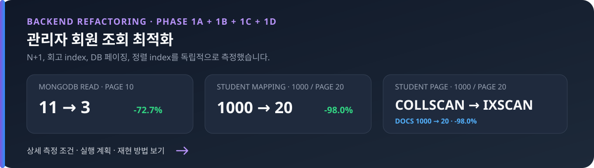

# 로컬 검증 결과 상세

README의 7절에서 요약한 측정의 전체 표와 조건입니다. 모든 수치는 로컬 fixture 기준이며 운영 처리량이나 응답 시간 개선율이 아닙니다.

## 카테고리 메타데이터 파이프라인

| 검증 항목 | 결과 |
| --- | --- |
| 처리 범위 | 문제 1000~1005 |
| 최종 작업 상태 | `COMPLETED` |
| 처리 / 성공 / 실패 | 6 / 6 / 0 |
| 마지막 checkpoint | `1005` |
| MongoDB 저장 | 6개 문제의 `category`, `tags`, `level` 확인 |
| 브라우저 오류 | console·page·request 오류 0건 |

이 결과는 반복 촬영을 위한 로컬 fixture 검증이며, 실제 solved.ac·BOJ 네트워크 응답이나 운영 처리량을 측정한 값이 아닙니다.

## 관리자 회원 조회 최적화

| 단계 | 고정 조건 | 직접 비교 항목 | Before | After | 해석 |
| --- | --- | --- | ---: | ---: | --- |
| Phase 1A | 회원 12명·페이지 크기 10 | MongoDB 읽기 명령 | 11 | 2 | 81.8% 감소 |
| Phase 1B | 회고 12건·페이지 크기 1·5·10 | 회고 검사 문서 | 12 | 0 | 인덱스 키 검사는 남음 |
| Phase 1C | 회원 1,000명·첫 페이지 20명 | 매핑된 `Student` | 1,000 | 20 | 98.0% 감소 |
| Phase 1D | 회원 1,000명·페이지 크기 20 | 페이지·count 검사 문서 | 2,000 | 1,020 | 49.0% 감소, count는 `COLLSCAN` 유지 |

수치별 SHA, 반복 조건과 남은 비용은 [관리자 회원 조회 최적화 근거](./refactoring/be-refactor/ADMIN_QUERY_OPTIMIZATION_OVERVIEW.md)에 정리했습니다.
테스트 수와 JaCoCo 변화는 성능 수치와 섞지 않고 같은 문서의 역사적 검증 표에 분리했습니다.

## 통계 조회 데이터 축소

| 시나리오 | 직접 비교 항목 | Before | After | 변화 |
| --- | --- | ---: | ---: | ---: |
| 전체 통계·회고 1,200건 | 반환 회고 BSON | 5,230,680 B | 107,790 B | 97.94% 감소 |
| 2024년 히트맵·대상 366건 | 반환 회고 BSON | 5,230,680 B | 18,396 B | 99.65% 감소 |
| 2024년 히트맵·대상 366건 | 검사 문서 | 1,200 | 366 | 69.50% 감소 |

전체 통계는 필요한 필드만 조회하고, 연도별 히트맵은 날짜 범위와
`idx_retro_student_created` 인덱스를 사용합니다. 같은 MongoDB 7.0.16 fixture를
Before·After 각각 5회 실행했으며 기능 결과 hash는 같았습니다.
표의 BSON은 query가 선택한 회고 문서 크기의 합이며 endpoint 응답 시간이나
운영 처리량의 개선율이 아닙니다.
비교 조건과 수치의 범위는 [통계 조회 데이터 축소](./refactoring/be-refactor/PHASE_4A_STATISTICS_QUERY_OPTIMIZATION.md)에 정리했습니다.

## 관리자 대시보드 차트 집계

| 시나리오 | 직접 비교 항목 | Before | After | 변화 |
| --- | --- | ---: | ---: | ---: |
| 회원 월별 차트 | 반환 문서 | 240건 | 24건 | 90.00% 감소 |
| 회원 월별 차트 | 반환 논리 BSON | 635,160 B | 792 B | 99.88% 감소 |
| 해결 문제 월별 차트 | 반환 문서 | 240건 | 24건 | 90.00% 감소 |
| 해결 문제 월별 차트 | 반환 논리 BSON | 635,160 B | 792 B | 99.88% 감소 |
| 회고 월별 차트 | 반환 문서 | 1,200건 | 24건 | 98.00% 감소 |
| 회고 월별 차트 | 반환 논리 BSON | 5,176,340 B | 792 B | 99.98% 감소 |

전체 문서를 애플리케이션에서 묶는 대신 MongoDB가 기간 bucket만 반환합니다.
해결 문제는 전체 회원의 고유 `problemId`를 최초 성공 시점에 한 번만 반영하며,
주별 키는 ISO 주차 연도를 사용합니다. 수치는 회원 240명·회원별 풀이 24건·
회고 1,200건·24개월의 로컬 MongoDB 7.0.16 fixture에서 raw 결과 문서의 BSON
크기를 비교한 값입니다. 응답 시간이나 운영 처리량 개선율은 아닙니다.
비교 조건과 정합성 수정은 [관리자 대시보드 차트 집계](./refactoring/be-refactor/PHASE_6F_ADMIN_DASHBOARD_CHART_AGGREGATION.md)에 정리했습니다.

## 추천 카테고리 조회 단일화

| 시나리오 | 직접 비교 항목 | Before | After | 변화 |
| --- | --- | ---: | ---: | ---: |
| BFS·RELATED | `problems` find | 31 | 1 | 96.77% 감소 |
| BFS·RELATED | `students` 포함 find | 32 | 2 | 93.75% 감소 |

부모·형제 카테고리마다 나눠 실행하던 조회와 태그 조회를 하나의 MongoDB
조건으로 합쳤습니다. 같은 fixture에서 문제 ID와 대표·태그 매칭 근거를 묶은 기능
결과 hash는 전후가 같았습니다. 난이도 경계값과 `difficultyLevel`만 있는 이전
문서의 읽기 오류도 실제 MongoDB 테스트로 고정했습니다. 표는 `find` 명령 수
감소율이며 응답 시간이나 운영 처리량 개선율이 아닙니다.
[추천 카테고리 단일 조회](./refactoring/be-refactor/PHASE_6G_RECOMMENDATION_SINGLE_QUERY.md)에 조건과 남은 비용을 정리했습니다.

## 관리자 피드백 작성자 일괄 조회

| 페이지 크기 | 직접 비교 항목 | Before | After | 변화 |
| ---: | --- | ---: | ---: | ---: |
| 5 | MongoDB 읽기 명령 | 7 | 3 | 57.14% 감소 |
| 20 | MongoDB 읽기 명령 | 22 | 3 | 86.36% 감소 |
| 20 | `students` find | 20 | 1 | 95.00% 감소 |

피드백마다 전체 학생 문서를 조회하던 흐름을 현재 페이지 작성자의 `_id`와
`bojId` projection 한 번으로 바꿨습니다. 20건 페이지의 작성자 ID는 모두
서로 다르고 학생 문서는 19건만 있는 조건이며, 삭제된 작성자의 피드백도
`writerId`를 유지하고 `bojId=null`로 반환했습니다. 표는 MongoDB 읽기 명령 수
감소율이며 응답 시간이나 운영 처리량 개선율이 아닙니다.
[관리자 피드백 작성자 일괄 조회](./refactoring/be-refactor/PHASE_6I_ADMIN_FEEDBACK_BATCH_LOOKUP.md)에 fixture와 실행 계획을 정리했습니다.

## 문제 메타데이터 저장 명령 축소

| 시나리오 | 직접 비교 항목 | Before | After | 변화 |
| --- | --- | ---: | ---: | ---: |
| 신규 문제 6건 | `problems` MongoDB 명령 | 12 | 6 | 50.00% 감소 |
| 기존 상세가 있는 문제 6건 | `problems` MongoDB 명령 | 12 | 6 | 50.00% 감소 |

메타데이터 수집 전에 문제별로 실행하던 `find`를 없애고 필요한 필드만
upsert합니다. 두 시나리오 모두 `find 6 → 0`, `update 6 → 6`이었으며 기존 URL,
언어와 상세 내용은 유지됐습니다. 같은 MongoDB·Redis 이미지에서 Before·After를
각각 5회 실행했고 기능 결과 hash, Redis 명령과 solved.ac 호출 수는 같았습니다.
50.00%는 `problems` collection의 메타데이터 저장 명령 수 감소율이며 크롤러 전체
응답 시간이나 운영 처리량의 개선율이 아닙니다.
비교 조건과 남은 비용은 [문제 메타데이터 부분 갱신](./refactoring/be-refactor/PHASE_4B_CRAWLER_METADATA_UPSERT.md)에 정리했습니다.

## 3,400건 문제 상세 제한 병렬 수집

| 조건 | 순차 중앙값 | `K=4` 중앙값 | 변화 |
| --- | ---: | ---: | ---: |
| 3,400건·10ms 고정 지연·3회 | 55.632초 | 12.226초 | 77.96% 단축 |

외부 BOJ 호출 대신 10ms 후 결정적 상세를 반환하는 fixture를 사용했고,
MongoDB 7.0.16·Redis 7.2.5와 실제 작업 상태·부분 갱신 경로를 포함했습니다.
세 회 모두 문서 3,400건, 성공 3,400건, 누락·중복·미완성 상세 0건,
최종 결과 hash 일치를 확인했습니다. pacer를 끄고 측정한 로컬 파이프라인
비교이므로 실제 BOJ 3,400건 수집 시간이나 운영 처리량으로 해석하지 않습니다.
[제한 병렬 설계·검증·재현 방법](./refactoring/be-refactor/PHASE_6N_CRAWLER_DETAILS_BOUNDED_PARALLEL.md)에 정리했습니다.

## 문제 수집 작업 목록 일괄 조회

| 시나리오 | 직접 비교 항목 | Before | After | 변화 |
| --- | --- | ---: | ---: | ---: |
| index 작업 1건 | Redis 목록 읽기 명령 | 2 | 2 | 변화 없음 |
| index 작업 5건 | Redis 목록 읽기 명령 | 6 | 2 | 66.67% 감소 |
| index 작업 20건 | Redis 목록 읽기 명령 | 21 | 2 | 90.48% 감소 |
| 유효 20건·stale 2건 | Redis 조회·정리 명령 | 27 | 5 | 81.48% 감소 |

작업 index에서 ID를 읽은 뒤 상태를 `GET`으로 하나씩 조회하던 흐름을 index 조회
1회와 `MGET` 1회로 묶었습니다. 만료되거나 읽을 수 없는 상태의 index와 실패
원장도 모아서 정리합니다. 다만 `MGET`은 index의 상태 값 N개를 모두 읽고 필터와
페이징은 그 뒤 애플리케이션에서 처리합니다. 표는 Redis 명령 수 비교이며 전송
데이터, JSON 역직렬화, 응답 시간이나 운영 처리량의 개선율이 아닙니다. stale
혼합 행은 조회와 정리 쓰기 명령을 함께 센 값입니다.
[문제 수집 작업 목록 일괄 조회](./refactoring/be-refactor/PHASE_6J_CRAWLER_JOB_LIST_BATCH_READ.md)에 fixture와 명령별 측정 범위를 정리했습니다.

## 동시성·요청 제한 검증

### AI·인증

- **[AI 리뷰 중복 생성](./performance/runs/2026-06-21-DIDIMLOG-LOCAL-VERIFICATION.md)**
  - 조건: 동일 로그 50건 동시 요청·10회 반복
  - 결과: 각 회차 Gemini 호출 1회·저장 1건, 최종 `COMPLETED`, 잠금 잔존 0건

- **[AI 리뷰 잠금 소유권](./refactoring/be-refactor/PHASE_6C_AI_REVIEW_LOCK_OWNERSHIP.md)**
  - 조건: 실제 MongoDB 7.0.16, A lease 만료·B 재획득·A 완료/실패
  - 결과: 만료 직후와 B 재획득 뒤 A 갱신 0건, B 상태 보존·종료 성공

- **[AI 일일 사용량](./refactoring/be-refactor/PHASE_5A_AI_USAGE_ATOMIC_RESERVATION.md)**
  - 조건: 실제 Redis, 남은 사용자·전역 한도 각각 1회에서 20건 동시 예약·동일 예약 2회 반환
  - 결과: 각 경계 성공 1건·거절 19건, 카운터 한도 유지, 동일 예약은 1회만 감소

- **[Gemini 공급자 호출 제한](./refactoring/be-refactor/PHASE_6D_GEMINI_RATE_LIMIT_ATOMICITY.md)**
  - 조건: 실제 Redis 7.2.5, 최소 간격 키 없이 같은 시각에 20건 요청
  - 결과: 허용 15건·RPM 20·RPD 15 → 허용 1건·RPM 1·RPD 1

- **[인증 요청 제한](./refactoring/be-refactor/PHASE_2D_AUTH_RATE_LIMIT_ATOMICITY.md)**
  - 조건: 실제 Redis 동일 키 20건 동시 요청·한도 1건
  - 결과: 허용 1건·차단 19건, 최종 카운터 1

- **[Refresh Token 회전](./refactoring/be-refactor/PHASE_2B_REFRESH_TOKEN_ATOMIC_ROTATION.md)**
  - 조건: 실제 Redis 7.2.5, 같은 기존 토큰으로 20건 동시 교체
  - 결과: 성공 1건, 기존 토큰 0건, 새 토큰 1건

- **[OAuth 로그인 코드 교환](./refactoring/be-refactor/PHASE_2C_4_OAUTH_CODE_EXCHANGE.md)**
  - 조건: 실제 Redis, 같은 일회용 코드를 동시에 소비
  - 결과: 성공 1건, 이후 요청은 같은 만료·재사용 오류

- **[JWT 토큰 용도 분리](./refactoring/be-refactor/PHASE_2C_1_JWT_TOKEN_PURPOSE.md)**
  - 조건: 실제 Security Filter Chain에 Access·Refresh Token 전달
  - 결과: Access Token 인증 성공, Refresh Token의 보호 API 접근 401

- **비밀번호 재설정 코드 발급·소비**
  - 조건: 실제 MongoDB 7.0.16, 같은 회원 20건 동시 발급·같은 코드 20건 동시 재설정
  - 결과: 발급 오류 0건·활성 코드 1건, 재설정 성공 1건·실패 19건
  - 문서: [발급 정합성](./refactoring/be-refactor/PHASE_2B_3_PASSWORD_RESET_ISSUANCE_CONSISTENCY.md) · [원자적 소비](./refactoring/be-refactor/PHASE_2B_2_PASSWORD_RESET_ATOMIC_CONSUME.md)

- **[비밀번호 변경과 토큰 소유자 고정](./refactoring/be-refactor/PHASE_2E_PASSWORD_CHANGE_SESSION_REVOCATION.md)**
  - 조건: 실제 MongoDB 7.0.16·Redis 7.2.5, 기존 Access/Refresh Token·지연 로그인·BOJ ID 재사용·과거 Student 저장
  - 결과: 구 버전·다른 학생 토큰 거절, stale CAS·전체 저장 무변경

- **[로그인 프로필 동기화](./refactoring/be-refactor/PHASE_2C_2_LOGIN_PROFILE_PARTIAL_UPDATE.md)**
  - 조건: 실제 MongoDB, solved.ac 조회 대기 중 비밀번호 재설정
  - 결과: 새 비밀번호 유지, rating·tier 필드만 갱신

### 사용자·학습 데이터

- **[가입·회고 DB 정합성](./refactoring/be-refactor/PHASE_2A_DATA_CONSISTENCY.md)**
  - 조건: 실제 MongoDB, 같은 학생·문제 회고 2건 동시 insert
  - 결과: 학생 식별자 중복 거부, 회고 1건 저장, 기존 중복 데이터 자동 삭제 0건

- **[풀이 결과 동시 저장](./refactoring/be-refactor/PHASE_3A_STUDY_SOLUTION_CAS.md)**
  - 조건: 실제 MongoDB 7.0.16, 같은 문서 버전의 다른 문제 2건·같은 문제 2건·비밀번호 변경 경합
  - 결과: 다른 문제 2건 모두 보존, 같은 문제 당일 1건, 새 자격 증명 유지

- **[회고 저장소 원자 연산](./refactoring/be-refactor/PHASE_3B_RETROSPECTIVE_ATOMIC_UPDATES.md)**
  - 조건: 실제 MongoDB 7.0.16·lifecycle 잠금 제외, 북마크 2건 동시 토글·최초 작성 2건·수정 중 선행 삭제
  - 결과: 토글 2회 모두 반영, 회고 1건 저장, 삭제 뒤 기존 ID 미복원

- **[계정 삭제 경로 통합](./refactoring/be-refactor/PHASE_3C_ACCOUNT_DELETION_CONSISTENCY.md)**
  - 조건: 실제 MongoDB 7.0.16, 본인 탈퇴·관리자 삭제와 사용자 소유 5개 컬렉션
  - 결과: 두 경로 모두 같은 범위를 삭제하고 시스템·다른 사용자 데이터 보존

- **[계정 삭제와 쓰기 경합](./refactoring/be-refactor/PHASE_3D_ACCOUNT_WRITE_BARRIER.md)**
  - 조건: 실제 MongoDB 7.0.16·Redis 7.2.5, 템플릿 생성 선행·계정 삭제 선행 신규 회고
  - 결과: 충돌 요청 409, 재시도 삭제 뒤 Student·사용자 문서 0건

- **[기본 템플릿 삭제 정합성](./refactoring/be-refactor/PHASE_3E_TEMPLATE_REFERENCE_CONSISTENCY.md)**
  - 조건: 실제 MongoDB 7.0.16·Redis 7.2.5, 양쪽 기본값·삭제 실패·설정/삭제 경합
  - 결과: 참조 선행 해제, SYSTEM 참조 보존, 충돌 409, 재시도 뒤 깨진 참조 0건

### 문제 수집

- **[문제 상세·메타데이터 저장 경합](./refactoring/be-refactor/PHASE_5B_CRAWLER_DETAIL_PARTIAL_UPDATE.md)**
  - 조건: 실제 MongoDB 7.0.16, 상세 대상 조회 뒤 메타데이터·언어 갱신 후 상세 저장
  - 결과: 최신 메타데이터·언어 보존, 오래된 전체 문서 덮어쓰기 1건 → 0건, 삭제 대상 재생성 0건

- **[문제 수집 작업 상태](./refactoring/be-refactor/PHASE_6E_CRAWLER_JOB_STATE_CAS.md)**
  - 조건: 동일 Runnable 재실행, 실제 Redis 7.2.5의 두 서비스 상태 경합, 문제 6건 수집 명령 계측
  - 결과: 외부 호출 2건 → 1건, 취소 성공 2건 → 1건, 취소 뒤 최종 상태 `COMPLETED` → `CANCELLED`, 작업당 index `ZADD` 9회 → 1회

- **[문제 수집 재시작 고아 작업](./refactoring/be-refactor/PHASE_6K_CRAWLER_STARTUP_ORPHAN_RECOVERY.md)**
  - 조건: 실제 Redis 7.2.5, 진행 작업 2건·종료 작업 3건·두 서비스 12건 CAS 경합·실행 중 worker
  - 결과: 진행 작업만 `FAILED`, 종료 상태 원문 유지, 작업별 성공 전이 1회, 다음 문제 호출·완료 덮어쓰기 0건

- **[문제 수집 실패 항목 재시도](./refactoring/be-refactor/PHASE_6H_CRAWLER_FAILED_ITEM_RETRY.md)**
  - 조건: 실제 Redis 7.2.5, 1~5번 중 문제 ID 2만 실패·취소 뒤 늦은 실패 상태 저장
  - 결과: 재시도 시 2번 호출 0건 → 1건, 미복구 문제 1건 → 0건, 기존 성공 문제 재호출 0건

- **[문제 수집 재시도 대상 manifest](./refactoring/be-refactor/PHASE_6L_CRAWLER_TARGET_MANIFEST.md)**
  - 조건: 실제 Redis 7.2.5의 비연속 `[2, 5]`·혼합 `explicitIds + range`·손상 상태, MockK 비메타데이터 조회
  - 결과: 저장 대상 밖 호출 0건, 현재 DB 전체 조회 0건, 손상·처리 위치 불일치 자식 작업 0건

- **[문제 수집 worker lease](./refactoring/be-refactor/PHASE_6M_A_CRAWLER_WORKER_LEASE.md)**
  - 조건: 실제 Redis 7.2.5의 동시 claim·heartbeat/진행률 경합·lease 교체·취소, MockK 외부 클라이언트·저장소
  - 결과: claim 1건, MockK 외부 클라이언트·저장소 호출 각 1건, stale 상태·실패 원장 쓰기 0건, 종료 뒤 lease 0건

- **[문제 수집 만료 작업 인계](./refactoring/be-refactor/PHASE_6M_B_CRAWLER_WORKER_TAKEOVER.md)**
  - 조건: 실제 Redis 7.2.5의 `PENDING` 재제출·만료 `RUNNING` 경합·4개 작업 유형 manifest suffix·실행기 거부·손상 manifest
  - 결과: claim 성공 1건, 외부 호출·저장 각 1건, prefix 재호출 0건, 기존 카운터 보존, 삭제 대상 실패 기록, 유효 lease 갱신 0건

- **[문제 상세 제한 병렬 수집](./refactoring/be-refactor/PHASE_6N_CRAWLER_DETAILS_BOUNDED_PARALLEL.md)**
  - 조건: 3,400건, 10ms 고정 fixture, 실제 MongoDB 7.0.16·Redis 7.2.5, 3회 반복
  - 결과: 중앙값 55.632→12.226초, 77.96% 단축, 누락·중복·미완성 상세 0건, 결과 hash 일치

### 운영 정합성

- **[고아 데이터 읽기 전용 점검](./refactoring/be-refactor/PHASE_5C_ORPHAN_DATA_READ_ONLY_DRY_RUN.md)**
  - 조건: 실제 MongoDB 7.0.16 합성 fixture, 사용자 소유 관계 5개·기본 참조 2개
  - 결과: fixture 기대 고아 6건·깨진 기본 참조 2건 일치, 쓰기 단계 0건·점검 필드 전후 hash 동일

- **[유지보수 설정 원자화](./refactoring/be-refactor/PHASE_6B_MAINTENANCE_CONFIG_ATOMICITY.md)**
  - 조건: 실제 Redis 7.2.5, 종료 시각 만료·유한→무기한 변경·두 서비스 동시 설정
  - 결과: 설정 키 전체 만료, 무기한 설정 TTL 없음, 서로 다른 설정 조합 0건

위 항목은 로컬 MongoDB·Redis와 Gemini Mock을 사용한 정확성 검증이며 운영 성능을 뜻하지 않습니다.

상세 구현과 검증 근거는 각 항목의 제목에 연결했습니다.
