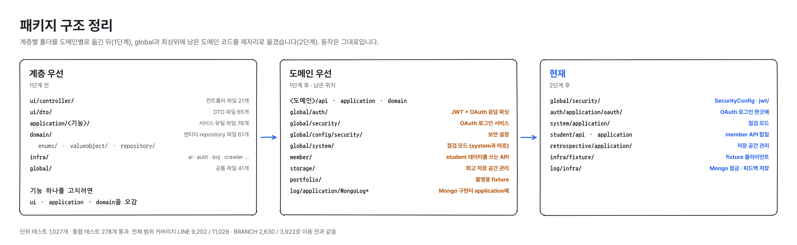

# 패키지 구조 정리



처음에는 `ui`, `application`, `domain`, `infra`처럼 계층별로 폴더를 나눴습니다. 기능이 17개로 늘면서 기능 하나를 고칠 때 네 폴더를 오가야 했고, 2026-11-27에 두 단계로 정리했습니다. 두 단계 모두 클래스 이름, API 경로, 동작은 바꾸지 않았습니다.

## 1단계: 계층 우선에서 도메인 우선으로

| 이전 | 파일 수 | 현재 |
| --- | ---: | --- |
| `ui/controller/` | 21 | `<도메인>/api/` |
| `ui/dto/` | 65 | `<도메인>/api/dto/` |
| `application/<기능>/`, `application/utils/` | 76 | `<도메인>/application/` |
| `domain/`, `domain/enums`, `domain/valueobject`, `domain/repository` 등 | 61 | `<도메인>/domain/`, `<도메인>/domain/repository/` |
| `infra/ai`, `infra/auth`, `infra/boj`, `infra/crawler` | 18 | `ai/infra/`, `auth/infra/`, `problem/infra/crawler/` |

`main` 소스 파일 289개를 옮겼고 파일 수는 그대로입니다. 여러 도메인이 함께 쓰는 `infra/solvedac`, `infra/email`과 공통 설정 `global`은 최상위에 남겼습니다.

## 2단계: 남은 위치 정리

1단계 뒤에도 `global`과 최상위에 도메인 코드가 남아 있었습니다.

| 문제 | 위치 | 영향 |
| --- | --- | --- |
| 보안 코드가 세 곳 | `global/auth`(JWT), `global/security`, `global/config/security` | 필터·토큰·보안 설정을 따로 찾아야 함 |
| 로그인 규칙이 공통 패키지에 | `global/security/CustomOAuth2UserService`(학생 조회·생성), `global/auth/oauth/info` | OAuth 로그인 코드를 `auth`에서 찾을 수 없음 |
| 같은 기능이 두 곳 | `global/system/MaintenanceModeService`, `system/api/PublicSystemController` | 점검 모드가 `global`과 `system`으로 나뉨 |
| 자기 도메인이 없는 최상위 패키지 | `member/`(Student 닉네임·온보딩), `storage/`(회고 저장 공간), `portfolio/`(촬영용 fixture) | 별도 도메인처럼 보이지만 다른 도메인의 데이터를 다룸 |
| 저장소 구현이 `application`에 | `log/application/MongoLog*Repository` | 포트와 구현을 나누는 다른 도메인(`auth/infra/redis`)과 규칙이 다름 |

### 이동 내용

| 이전 | 현재 | 비고 |
| --- | --- | --- |
| `global/auth/JwtTokenProvider`, `JwtAuthenticationFilter` | `global/security/jwt/` | |
| `global/config/security/SecurityConfig` | `global/security/` | 보안 설정과 JWT를 한 패키지에 |
| `global/security/CustomOAuth2UserService`, `OAuth2SuccessHandler` | `auth/application/oauth/` | 기존 `OAuthExchangeService`와 같은 곳 |
| `global/auth/oauth/info/OAuth2UserInfo*` (5개) | `auth/application/oauth/info/` | Google·GitHub·Naver 응답 파싱 |
| `global/system/MaintenanceModeService` | `system/application/` | 공개 상태 API와 같은 도메인 |
| `member/api/MemberController`, `member/api/dto/MemberNicknameDtos` | `student/api/`, `student/api/dto/` | API 경로 `/api/v1/members`는 그대로 |
| `member/application/MemberService` | `student/application/` | |
| `storage/application/StorageManagementService` | `retrospective/application/` | 회고 문서만 다룸 |
| `portfolio/PortfolioFixtureClients` | `infra/fixture/` | `portfolio-fixture` 프로필 전용 가짜 외부 클라이언트. 로그 레벨 키도 새 패키지로 |
| `log/application/MongoLogAiReviewLockRepository`, `MongoLogFeedbackRepository` | `log/infra/` | 포트 인터페이스는 `log/application`에 둠 |

단위·통합 테스트는 대상 클래스와 같은 패키지로 옮겼습니다. `build.gradle.kts`의 JaCoCo core 범위 경로도 새 위치로 고쳤습니다.

## 확인한 것

같은 Mac에서 정리 전 `main`과 정리 후 브랜치를 차례로 실행했습니다.

```bash
./gradlew clean test jacocoTestReport
./gradlew integrationTest
```

| 항목 | 이전 | 현재 |
| --- | --- | --- |
| 단위 테스트 | 1,027 passed | 1,027 passed |
| 통합 테스트 | - | 278 passed, 10 skipped |
| 전체 범위 LINE | 9,202 / 11,028 (83.44%) | 9,202 / 11,028 (83.44%) |
| 전체 범위 BRANCH | 2,630 / 3,922 (67.06%) | 2,630 / 3,922 (67.06%) |
| core 범위 LINE | 4,817 / 5,178 (93.03%) | 4,784 / 5,197 (92.05%) |
| core 범위 BRANCH | 1,529 / 1,971 (77.57%) | 1,532 / 1,995 (76.79%) |

전체 범위는 `main` 소스 전부(`jacocoFullMergedReport`와 같은 범위)를 단위 테스트 실행 데이터만으로 잰 값이고, 이동 전후 숫자가 같습니다. core 범위는 `build.gradle.kts`가 경로로 고르는 집합이라 클래스 위치가 바뀌면 모집단이 바뀝니다. OAuth 로그인 클래스 두 개가 `auth/application`으로 들어오면서 core에 새로 포함됐고, Mongo 저장소 구현 두 개는 `log/infra`로 나가면서 빠졌습니다. 그래서 core 숫자의 차이는 테스트가 늘거나 줄어서 생긴 것이 아닙니다.

## 남겨둔 것

| 위치 | 이유 |
| --- | --- |
| `global/util/CodeLanguageDetector` | `log`와 `template` 두 도메인이 씀. 반환 타입이 `student.domain.PrimaryLanguage`라 공통 패키지가 도메인에 의존함 |
| `infra/solvedac/ProblemCategoryMapper` | solved.ac 응답 태그를 `ProblemCategory`로 바꾸는 번역 코드라 solved.ac 클라이언트 옆에 둠 |
| `global/exception`의 도메인 예외 | `DuplicateNicknameException`, `AiGeneration*Exception` 등을 `GlobalExceptionHandler`가 직접 처리함. `FeedbackNotFoundException`, `QuoteNotFoundException`은 main 코드에서 던지는 곳이 없음 |
| `application`에서 `MongoTemplate`·`RedisTemplate`를 직접 쓰는 서비스 | 관리자 통계 집계와 문제 수집 상태 저장. 조회 최적화와 Lua CAS가 이 코드에 있어 별도 작업으로 다룸 |
