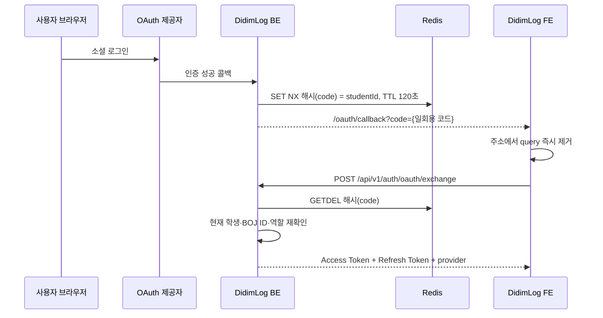

# OAuth 일회용 코드 교환

OAuth 로그인 성공 뒤 Access Token을 콜백 URL에 싣던 것을, 120초짜리 일회용 코드를 넘기고 API로 토큰을 교환하도록 바꿨습니다. URL에 토큰과 개인정보가 남지 않고, 연결된 소셜 계정으로 로그인이 끝까지 됩니다.

## 이전과 현재

| 상황 | 이전 | 현재 |
| --- | --- | --- |
| 콜백 URL | `/oauth/callback?token={accessToken}` | `/oauth/callback?code={일회용 코드}` |
| 연결된 계정 로그인 | Refresh Token이 없어 FE가 로그인을 끝내지 못함 | 교환 API가 두 토큰을 함께 돌려줌 |
| 신규 사용자 분기 | URL에 이메일·providerId 포함 | 개인정보 없이 `oauth_signup_not_supported` |
| 같은 코드 20건 동시 교환 | - | 학생 ID를 얻는 요청 1건 |
| 만료·없는·재사용 코드 | - | 모두 400 `OAUTH_EXCHANGE_CODE_INVALID` |
| GitHub·Naver 계정 표시 | FE 기본값으로 Google 표시 | 응답의 실제 provider 표시 |

로컬 Redis 통합 테스트로 확인했습니다. 보안 경계와 FE·BE 계약을 바로잡은 변경이라 응답 시간은 측정하지 않았습니다.

## 문제

OAuth 성공 처리는 Access Token만 콜백 URL에 넣었고, FE는 Access Token과 Refresh Token이 모두 있어야 로그인을 마쳤습니다. 그래서 연결된 계정도 로그인을 끝낼 수 없었습니다.

URL의 토큰은 브라우저 방문 기록, Referer, 프록시 접근 로그에 남을 수 있습니다. 신규 사용자 분기는 이메일과 providerId까지 URL에 담았는데, 신규 OAuth 가입 마무리 API는 이미 `410 Gone`이라 이 정보를 넘길 이유가 없었습니다.

## 바꾼 내용

| 경계 | 처리 |
| --- | --- |
| 코드 | 256비트 URL-safe 난수 |
| 저장 | 원문 대신 SHA-256 해시를 키로, 내부 `studentId`를 값으로 `SET NX`, TTL 120초 |
| 소비 | `GETDEL` 한 번 |
| 토큰 발급 조건 | 코드 소비 뒤 다시 조회한 학생이 BOJ ID가 있고 `USER`나 `ADMIN`일 때 |
| 성공 응답 | `Cache-Control: no-store`, `Pragma: no-cache` |
| 리다이렉트 응답 | `no-store`, `no-cache`, `Referrer-Policy: no-referrer` |

FE는 첫 비동기 요청 전에 주소에서 query를 지우고, StrictMode에서도 교환을 한 번만 요청합니다.

## 확인한 방법

- 리다이렉트 URL에 Access Token, Refresh Token, 이메일, providerId가 없는지 확인합니다.
- 실제 Redis에서 같은 코드를 20건 동시에 소비해 학생 ID를 얻는 요청이 1건인지 확인합니다.
- 삭제된 학생, BOJ 미연동 학생, `GUEST`에게 토큰을 발급하지 않는지 확인합니다.
- OAuth 교환 단위 테스트 17개가 통과하고, `./gradlew clean check`가 통과했습니다(단위 545개, 통합 91개 중 84개 통과·조건부 7개 제외).

## 남은 한계

- 일회용 코드도 120초 동안은 로그인에 쓸 수 있습니다. 최초 FE 문서 요청의 URL은 호스팅 접근 로그에 남을 수 있고, 코드를 브라우저 요청과 묶는 PKCE나 nonce는 아직 없습니다.
- 브라우저 저장소의 Refresh Token을 HttpOnly 쿠키로 옮길지는 정하지 않았습니다.
- 신규 OAuth 가입을 다시 열려면 provider 정보를 서버에 묶은 별도 가입 코드가 필요합니다.
- BE 인스턴스를 순차 배포할 때는 교환 API를 먼저 배포한 뒤 리다이렉트를 바꿔야 합니다.
