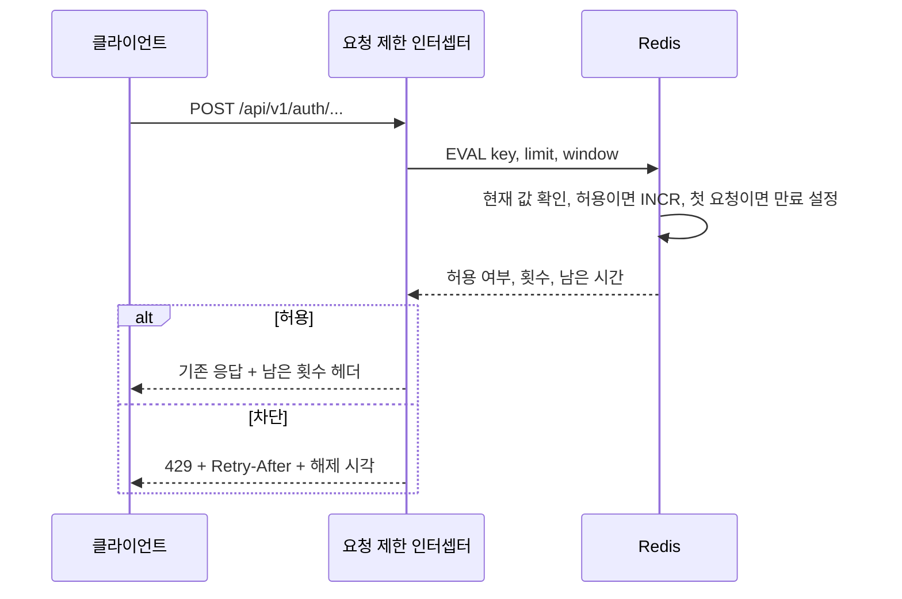

# 인증 요청 제한 원자화

로그인, 가입, 계정 복구, BOJ 인증의 요청 제한을 Redis Lua 한 번으로 확인·기록하도록 바꿨습니다. 동시에 몰린 요청이 한도를 넘지 않고, 헤더를 바꿔 제한을 피하는 경로도 막았습니다.

## 이전과 현재

| 상황 | 이전 | 현재 |
| --- | --- | --- |
| 한도 1건인 키에 20개 동시 요청 | 같은 값을 읽고 여러 건 통과 가능 | 허용 1건, 차단 19건, 카운터 1 |
| 허용 요청마다 만료 시간 | 다시 1시간으로 연장 | 첫 요청의 만료 시각 유지 |
| `INCR` 뒤 `EXPIRE` 실패 | 만료 없는 키가 남음 | 다음 요청에서 만료 복구 |
| `X-Forwarded-For` 헤더 변경 | 매번 새 제한 키 | Nginx가 덮어쓴 실제 주소만 사용 |
| 정상 로그인 성공 | 같은 IP의 실패 카운터 초기화 | 초기화하지 않음 |
| Redis 왕복 (허용 / 차단) | 3회 / 2회 | 1회 / 1회 |

## 문제

요청 제한은 값을 읽고, 한도와 비교하고, 증가시키고, 만료를 설정하는 네 단계로 나뉘어 있었습니다.

```text
GET → 한도 비교 → INCR → EXPIRE
```

같은 키로 동시에 요청이 오면 여러 요청이 같은 값을 읽고 모두 통과할 수 있었습니다. 허용될 때마다 만료 시간이 다시 1시간으로 늘어 문서에 적힌 고정 구간과도 달랐습니다.

요청 주소는 `X-Forwarded-For`와 `X-Real-IP`를 그대로 믿어서, 헤더만 바꾸면 제한 키를 계속 새로 만들 수 있었습니다. 정상 계정으로 로그인하면 카운터를 지워서 같은 IP의 무차별 대입 예산을 되돌릴 수도 있었습니다.

## 바꾼 내용

### Lua 한 번으로 확인과 기록



차단 요청은 카운터를 올리지 않고, 첫 요청이 정한 만료 시각을 늘리지 않습니다. Redis 연결 실패나 시간 초과면 요청을 통과시키지 않고 503 `RATE_LIMIT_SERVICE_UNAVAILABLE`을 돌려줍니다.

### 실제 연결 주소만 사용

Spring Boot의 `RemoteIpValve`가 고정 주소의 Nginx만 내부 프록시로 믿고, Nginx는 클라이언트가 보낸 전달 헤더를 실제 연결 주소로 덮어씁니다. BE의 8080 포트는 `127.0.0.1`에만 열어 Nginx를 건너뛰지 못하게 했습니다. 정책은 원본 URI가 아니라 Spring MVC가 매칭한 경로로 골라서 `/log%69n` 같은 인코딩 경로로도 우회할 수 없습니다.

### 적용 정책

| 키 | 경로 | 제한 |
| --- | --- | ---: |
| `signup:{주소}` | `/signup`, `/super-admin` | 합계 5건/60분 |
| `login:{주소}` | `/login` | 10건/60분 |
| `password_reset:{주소}` | 계정·비밀번호 찾기, 재설정 | 합계 3건/60분 |
| `boj_code:{주소}` | `/boj/code` | 5건/1분 |
| `boj_verify:{주소}` | `/boj/verify` | 10건/1분 |

## 확인한 방법

- 실제 Redis 통합 테스트로 20개 동시 요청 중 1건 허용, 차단 요청의 카운터 불변, 만료 미연장, 만료 없는 이전 키 복구, 구간이 끝난 뒤 다음 요청 허용을 확인합니다.
- 로컬 Spring Boot 서버에 k6로 정책별 요청을 동시에 보냈습니다.

| 정책 | 보낸 요청 | 허용 | 429 |
| --- | ---: | ---: | ---: |
| 회원가입 | 7 | 5 | 2 |
| 로그인 | 12 | 10 | 2 |
| 계정 복구 | 5 | 3 | 2 |

- 전체 검증에서 단위 577개, 통합 99개 중 92개 통과(조건부 7개 제외)였고, 요청 제한 분기 테스트가 늘어 전체 범위 Line 커버리지가 65.54%에서 66.68%로 올랐습니다.

```bash
./gradlew test --tests '*ratelimit*' --tests '*WebInterceptorConfigTest'
./gradlew integrationTest --tests '*RateLimitServiceIntegrationTest'
performance/k6/run-local.sh rate-limit
```

## 남은 한계

- Docker 네트워크 대역을 바꾸면 Nginx 고정 주소와 신뢰 프록시 패턴을 함께 바꿔야 합니다.
- 여러 사람이 같은 IP를 쓰는 환경에서 계정 단위 보조 제한이 필요한지는 운영 자료를 보고 판단해야 합니다.
