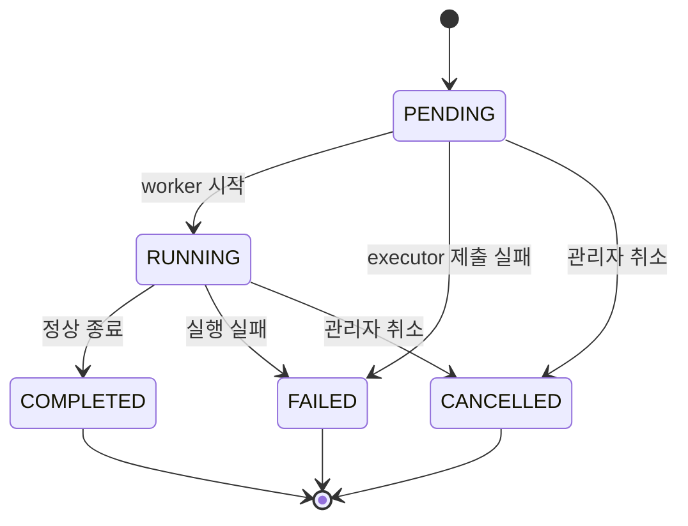

# 문제 수집 작업 상태 원자 전이

문제 수집 작업의 상태를 Redis에서 "읽은 값이 그대로일 때만 바꾸는" 방식으로 바꿨습니다. 서버가 여러 대여도 취소된 작업이 다시 실행 중이나 완료로 되돌아가지 않습니다.

## 이전과 현재

| 확인 항목 | 이전 | 현재 |
| --- | ---: | ---: |
| 같은 작업을 두 번 실행했을 때 solved.ac 호출 | 2건 | 1건 |
| 같은 상태를 읽은 두 취소 요청 중 성공 | 2건 | 1건 |
| 취소 뒤 늦게 도착한 진행률 저장의 최종 상태 | `COMPLETED` | `CANCELLED` |
| 문제 6건 작업의 목록 index 쓰기(`ZADD`) | 9회 | 1회 |

두 서버가 같은 Redis를 쓰는 조건에서 잰 정확성 기준입니다. 응답 시간이나 처리량은 재지 않았습니다.

## 문제

작업 상태는 Redis에 저장했지만, 갱신 순서는 서버 안의 `synchronized`로만 지켰습니다.

```text
상태 읽기 → 서버에서 다음 상태 계산 → 상태 저장 → 목록 index 저장
```

서버가 한 대면 문제가 없지만 두 대가 같은 Redis를 쓰면 둘 다 같은 상태를 읽을 수 있습니다. 한 서버가 작업을 취소한 뒤 다른 서버의 오래된 진행률 저장이 도착하면 `CANCELLED`가 `RUNNING`이나 `COMPLETED`로 덮어써졌습니다.

시작 처리(`markRunning`)는 `PENDING`이 아닌 작업도 성공으로 처리해서, 같은 작업이 다시 실행되면 solved.ac 호출과 MongoDB 저장이 반복됐습니다. 상태를 바꿀 때마다 바뀌지 않는 목록 index도 다시 썼습니다.

## 바꾼 내용

### 생성은 한 번에

새 작업의 상태 키와 목록 index를 Lua 스크립트 하나로 함께 만듭니다. 상태 키가 이미 있으면 아무것도 바꾸지 않고, index 키의 자료형도 먼저 확인해서 상태만 만들어지고 index가 빠지는 경우를 막습니다.

### 읽은 원문과 비교한 뒤 갱신

응답 DTO에 버전 필드를 추가하지 않고, Redis에서 읽은 JSON 문자열 자체를 기대값으로 씁니다. Lua가 현재 값이 기대값과 같을 때만 새 값을 저장합니다. 비교에 실패하면 최신 상태를 다시 읽거나, 진행률처럼 이미 늦은 값은 버립니다.



| 동작 | 허용 상태 | 비교 실패 시 |
| --- | --- | --- |
| worker 시작 | `PENDING` | 해당 실행 종료 |
| 진행률 저장 | `RUNNING` | 오래된 진행률 버림 |
| 완료 | `RUNNING` | 최신 상태가 `RUNNING`일 때만 재시도 |
| 실행 실패 | `PENDING`, `RUNNING` | 허용 상태일 때만 재시도 |
| 취소 | `PENDING`, `RUNNING` | 최신 상태를 다시 읽고 최대 4회 시도 |

`COMPLETED`, `FAILED`, `CANCELLED`가 된 작업은 이후 진행률·완료·실패 저장으로 바뀌지 않습니다. 동시 취소에서 진 요청은 `JOB_ALREADY_TERMINAL`(409)을, 재시도를 다 써도 상태가 계속 바뀌면 `RESOURCE_STATE_CONFLICT`(409)를 돌려줍니다.

### 목록 index는 생성 때 한 번만

작업 생성 시각과 목록 포함 여부는 생성 뒤 바뀌지 않으므로 `ZADD`는 생성 스크립트에서만 실행합니다. 같은 문제 6건 작업에서 9회가 1회로 줄었고, 수집 결과·MongoDB 갱신 수(6건)·solved.ac 호출 수(6건)는 그대로였습니다.

## 확인한 방법

- 로컬 MongoDB 7.0.16, Redis 7.2.5에서 서버 객체 두 개가 같은 Redis를 쓰게 하고, 회귀 테스트를 변경 전 코드에 먼저 돌려 위 "이전" 값을 확인했습니다.
- 실제 Redis 경합 통합 테스트를 5회 연속 통과했고, 두 worker가 동시에 시작해도 하나만 실행됐습니다.
- 전용 MongoDB·Redis에 연결한 `./gradlew clean check`가 통과했습니다.

```bash
./gradlew test --tests '*ProblemCollectorServiceTest' \
  integrationTest --tests '*ProblemCollectorJobStateIntegrationTest'
```

## 남은 한계

- 이전 버전 worker는 비교 없이 상태를 덮어씁니다. 이전 버전과 함께 돌리지 않고 전체를 교체해야 합니다.
- 생성 스크립트가 키 두 개를 함께 씁니다. 지금은 단일 Redis 기준이고, Redis Cluster로 옮기면 같은 hash slot을 보장해야 합니다.
- 작업 상태는 24시간 뒤 만료됩니다.
- 취소는 항목 사이에서 확인하므로 이미 시작한 외부 호출을 바로 끊지는 않습니다.

이후 작업에서 [실패 항목 재시도](./PHASE_6H_CRAWLER_FAILED_ITEM_RETRY.md), [작업 목록 일괄 조회](./PHASE_6J_CRAWLER_JOB_LIST_BATCH_READ.md), [재시작 시 고아 작업 정리](./PHASE_6K_CRAWLER_STARTUP_ORPHAN_RECOVERY.md)를 더했습니다.
