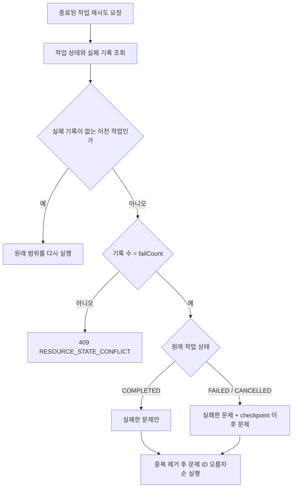

# 문제 수집 실패 항목 재시도

수집 중 실패한 문제를 작업별로 따로 기록해 두고, 재시도할 때 그 문제를 반드시 다시 처리하도록 바꿨습니다. 이미 성공한 문제는 다시 호출하지 않습니다.

## 이전과 현재

| 확인 항목 | 이전 | 현재 |
| --- | ---: | ---: |
| 재시도에서 실패했던 문제(2번)를 다시 호출 | 0건 | 1건 |
| 재시도 뒤에도 복구되지 않은 문제 | 1건 | 0건 |
| 이미 성공한 1·3·4·5번 재호출 | 0건 | 0건 |
| 상세 수집 대상의 처리 순서 어긋남 | 1건 | 0건 |

문제 1~5번 중 2번만 한 번 실패하게 만든 조건에서 비교했습니다. 재시도 대상 선택의 정확성을 본 것이고, 응답 시간이나 처리량은 재지 않았습니다.

## 문제

수집 작업은 항목 하나가 실패해도 다음 항목을 계속 처리합니다. 이때 실패 수는 늘지만 진행 위치(checkpoint)도 마지막 문제까지 함께 전진합니다.

```text
status=COMPLETED, processedCount=5, successCount=4, failCount=1, lastCheckpointId=5
```

기존 재시도는 checkpoint 다음 범위만 골랐습니다. 위 작업은 checkpoint가 이미 끝에 있어서, 실패한 2번을 다시 처리하지 않고 처리할 것이 없는 `COMPLETED` 작업만 만들었습니다.

상세 수집 대상은 MongoDB 조회 결과를 정렬하지 않아 `1005, 1001, 1003` 순서로 처리되기도 했습니다. 이 상태로 중단되면 checkpoint보다 작은 미처리 문제가 재시도에서 빠질 수 있었습니다.

## 바꾼 내용

### 실패 문제 기록

작업마다 실패한 문제 ID를 Redis Set에 저장합니다.

```text
problem:job:status:{jobId}    작업 상태 JSON
problem:job:failures:{jobId}  실패 문제 ID Set
problem:job:index             작업 목록
```

실패 항목을 저장할 때 Lua 스크립트가 현재 상태가 기대값과 같은지 확인한 뒤, 실패 ID 추가와 상태 저장, 두 키의 24시간 만료 설정을 한 번에 처리합니다. Lua는 중간에 오류가 나도 앞의 명령을 되돌리지 않으므로, 실패 기록 키의 자료형을 가장 먼저 확인하고 맞지 않으면 아무것도 바꾸지 않습니다.

### 재시도 대상 고르기



- `COMPLETED` 작업은 실패한 문제만 다시 처리합니다.
- `FAILED`, `CANCELLED` 작업은 실패한 문제와 아직 처리하지 않은 문제를 합칩니다.
- 같은 문제는 한 번만 고르고, 문제 ID 오름차순으로 처리합니다.
- 실패 기록 수와 `failCount`가 다르거나 기록 키의 자료형이 다르면 새 작업을 만들지 않고 409를 돌려줍니다.
- 실패 기록을 도입하기 전에 만든 작업은 구분할 방법이 없으므로 원래 범위를 다시 실행합니다.
- 그사이 MongoDB에서 지워진 문제는 건너뜁니다.

## 확인한 방법

- 변경 전 코드에 회귀 테스트를 먼저 돌려 위 "이전" 값을 확인했습니다.
- 단위 테스트 20건과 실제 Redis 통합 테스트 9건이 통과했습니다. 실패 문제만 재시도, 취소 작업의 합집합, 이전 작업 처리, 기록 불일치 409, 지워진 문제 제외, 잘못된 키 자료형에서 부분 저장 0건을 확인했습니다.
- 정상 수집 6건을 다시 실행해 수집 결과, MongoDB 갱신 6건, solved.ac 호출 6건이 이전 단계와 같은지 확인했습니다.
- 전용 MongoDB·Redis에 연결한 `./gradlew clean check`가 통과했습니다.

```bash
./gradlew test --tests '*ProblemCollectorServiceTest' \
  integrationTest --tests '*ProblemCollectorJobStateIntegrationTest'
```

## 남은 한계

- 같은 작업의 재시도 요청이 동시에 오면 재시도 작업이 여러 개 만들어질 수 있습니다.
- 취소는 항목 사이에서 확인하므로 이미 시작한 외부 호출은 끝까지 갑니다.
- 상태와 실패 기록은 24시간 뒤 만료됩니다.
- 여러 키를 쓰는 Lua는 단일 Redis 기준입니다.

재시도 대상이 연속되지 않을 때 범위만 저장하던 문제는 [문제 수집 대상 manifest](./PHASE_6L_CRAWLER_TARGET_MANIFEST.md)에서 실제 대상 목록을 저장하도록 고쳤습니다.
