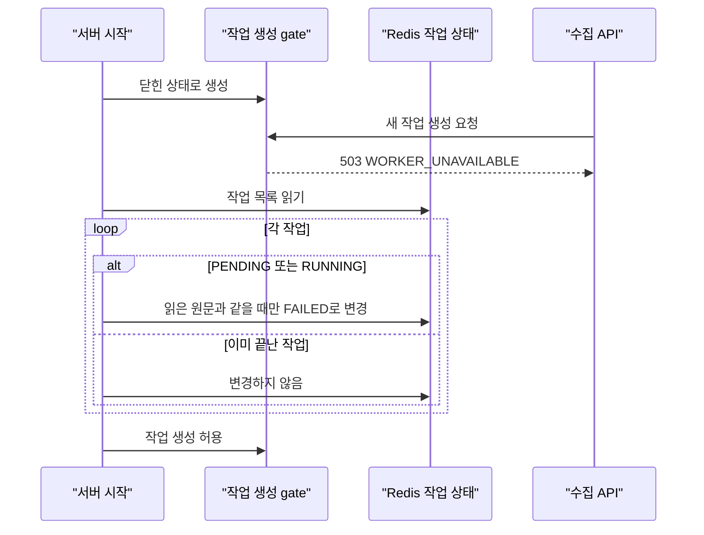

# 문제 수집 재시작 고아 작업 정리

서버가 수집 도중 재시작되면 실행 주체 없이 "진행 중"으로 남던 작업을, 다음 시작 때 실패로 정리하고 재시도할 수 있게 바꿨습니다.

## 이전과 현재

| 상황 | 이전 | 현재 |
| --- | --- | --- |
| 수집 중 서버 재시작 뒤 작업 상태 | `PENDING`·`RUNNING`으로 24시간 남음 | 시작 시 `FAILED`(`WORKER_UNAVAILABLE`)로 정리 |
| 남은 작업 재시도 | 종료 상태가 아니라 불가 | 기존 재시도 API로 새 작업 생성 |
| 정리 중 새 수집 요청 | 받음 | 정리가 끝날 때까지 503 |
| 정리 뒤 늦게 끝난 worker의 완료 덮어쓰기 | 막는 장치 없음 | 0건 |
| 진행 수치·checkpoint·실패 기록 | - | 그대로 보존 |

## 문제

작업 상태는 Redis에 24시간 남지만, 실제로 실행하는 코드는 서버 프로세스 안의 `TaskExecutor`에 있습니다. 서버가 하나뿐인 환경에서 작업 중 재시작하면 실행 주체는 사라지고 Redis에는 `PENDING`이나 `RUNNING`만 남았습니다. 이 작업은 스스로 진행되지도 끝나지도 않아서 재시도 API도 쓸 수 없었고, 관리자 화면에는 멈춘 작업으로 남았습니다.

## 바꾼 내용

### 적용 범위

서버 한 대가 통째로 재시작하는 경우만 다룹니다. 어떤 문제를 처리했는지와 어느 서버가 작업을 가졌는지 저장하지 않은 상태에서 자동으로 이어 실행하면, 이미 처리한 문제를 다시 실행하거나 다른 서버의 정상 작업을 실패로 만들 수 있습니다. 그래서 이어 실행하지 않고 안전하게 끝내는 쪽을 골랐습니다.

| 위치 | 설정 | 이유 |
| --- | --- | --- |
| 애플리케이션 기본값 | 끔 | 서버가 몇 대인지 알 수 없음 |
| 서버 한 대인 Docker Compose | 켬 | 시작 시 이전 진행 작업 정리 |
| 서버 여러 대·순차 배포 | 끔 | 다른 서버의 작업 보호 |

환경 변수는 `PROBLEM_COLLECTOR_FAIL_ORPHANED_JOBS_ON_STARTUP`입니다.

### 시작 순서



정리가 끝난 뒤에만 새 작업을 받습니다. Redis 연결 오류처럼 정리 자체를 믿을 수 없으면 서버 시작을 실패시키고 gate도 닫아 둡니다. 정리 메서드는 시작 단계에서만 실행되므로, 운영 중에 다시 불러 정상 작업을 한꺼번에 끝낼 수 없습니다.

### 늦게 끝나는 worker 막기

worker는 다음 항목을 시작하기 전과 완료를 저장하기 전에 상태가 `RUNNING`인지 확인합니다. 정리가 작업을 `FAILED`로 바꾸면 다음 항목 처리와 완료 덮어쓰기가 멈춥니다. 이미 시작한 외부 호출 한 건과 그 저장은 끝날 수 있습니다.

## 확인한 방법

로컬 Redis 7.2.5의 별도 DB에서 확인했습니다.

| 조건 | 결과 |
| --- | --- |
| 진행 중 2건과 종료 3건 | 진행 중 2건만 `FAILED`, 종료 3건은 원문 그대로 |
| 서버 두 개가 고아 작업 12건을 동시에 정리 | 작업마다 한 번만 바뀜 |
| 손상된 JSON 1건과 정상 1건 | 손상된 것은 건너뛰고 정상 작업 정리 |
| 상태 키 자료형이 잘못됨 | 시작 실패, gate 닫힌 채 유지 |
| 첫 문제 처리 중 정리 | 두 번째 외부 호출 0건, 완료 덮어쓰기 0건 |

전용 MongoDB 7.0.16·Redis 7.2.5에 연결한 `./gradlew clean check`가 통과했습니다. 단위 테스트는 738개에서 744개로, 통과한 통합 테스트는 215개에서 221개로 늘었습니다.

```bash
./gradlew integrationTest \
  --tests '*ProblemCollectorOrphanRecoveryIntegrationTest' \
  --tests '*ProblemCollectorJobStateIntegrationTest'
```

## 남은 한계

- 작업을 이어서 실행하지 않습니다. 원래 작업은 `FAILED`로 남고, 재시도는 새 작업을 만듭니다.
- 서버 여러 대에서 쓰는 소유권과 인계는 이 단계에 없습니다. 이후 [worker lease](./PHASE_6M_A_CRAWLER_WORKER_LEASE.md)와 [만료 작업 자동 인계](./PHASE_6M_B_CRAWLER_WORKER_TAKEOVER.md)에서 더했습니다.
- 시작할 때 모든 작업을 확인하므로 작업이 많으면 시작이 늦어질 수 있습니다.
