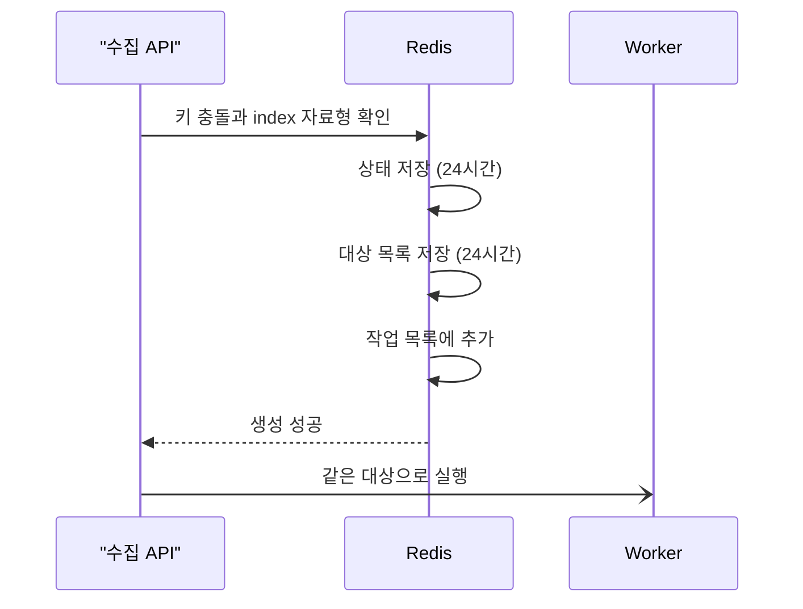

# 문제 수집 대상 manifest

작업을 만들 때 처리할 문제 ID와 순서를 따로 저장해 두고, 재시도는 그 목록 안에서만 고르게 바꿨습니다.

## 이전과 현재

| 상황 | 이전 | 현재 |
| --- | --- | --- |
| `[2, 5]` 재시도 작업이 2번 처리 뒤 취소됨 | 응답에 `2..5` 범위만 남아 3·4번까지 다시 처리될 수 있음 | 5번만 다시 처리, 3·4번 호출 0건 |
| 상세·언어 작업 재시도 | 재시도 시점의 DB를 다시 조회해 새로 추가된 문제가 섞일 수 있음 | 원래 대상 중 남은 ID만 조회 |
| 대상 정보가 사라지거나 손상됨 | 구분할 방법 없음 | 409로 거절, 재시도 작업 0건 |

응답 시간이나 처리량을 줄이는 변경이 아니라, 재시도가 원래 대상을 벗어나지 않게 고정하는 변경입니다.

## 문제

작업 상태에는 공개 범위와 마지막 처리 위치(checkpoint)만 있고, worker가 실제로 처리한 목록은 남지 않았습니다.

- 떨어진 문제 `{2, 5}`를 재시도하는 작업은 `range=2..5`로만 저장돼, 다시 중단되면 3번과 4번까지 처리할 수 있었습니다.
- 상세 수집, 상세 새로고침, 언어 갱신은 재시도할 때 DB를 다시 조회해서 원래 작업 뒤에 추가된 문제가 섞였습니다.
- 상태가 가리키는 대상이 사라지거나 손상돼도 알 수 없었습니다.

## 바꾼 내용

### 대상 목록 저장

새 작업은 상태와 별도로 대상 목록(manifest)을 저장합니다. 상태에는 목록 원문의 해시만 넣어서, 목록을 반복 저장하지 않으면서도 상태와 목록이 짝이 맞는지 확인할 수 있습니다.

```text
problem:job:status:{jobId}    작업 상태
problem:job:targets:{jobId}   대상 목록
problem:job:failures:{jobId}  실패 문제 ID
problem:job:index             작업 목록
```

```json
{ "version": 1, "jobId": "job-id", "jobType": "COLLECT_METADATA",
  "explicitIds": ["2"], "range": { "start": 4, "end": 5 } }
```

처리 순서는 `explicitIds` 다음에 `range`를 이어 붙인 것입니다. 큰 연속 범위는 ID를 모두 펼치지 않고, 떨어진 대상은 범위로 줄이지 않습니다.

| 작업 | 저장 형태 |
| --- | --- |
| 처음 실행하는 메타데이터 범위 | 연속 `range` |
| 떨어진 메타데이터 대상 | `explicitIds` |
| 실패한 문제 + 남은 연속 구간 | `explicitIds` + `range` |
| 상세 수집·새로고침·언어 갱신 | 처리 순서대로 `explicitIds` |

### 한 번에 생성

상태, 대상 목록, 작업 목록 index를 Lua 하나로 만듭니다. 키 충돌이나 자료형 문제가 있으면 셋 다 저장하지 않습니다.



### 재시도 전 검증

대상 목록이 있는 작업은 재시도 전에 자료형, 해시, 버전, 중복 ID, 대상 수, 처리 수, checkpoint, 실패 ID 위치를 확인합니다. 하나라도 맞지 않으면 409를 돌려주고 재시도 작업을 만들지 않습니다.

- `COMPLETED` 작업: 실패한 문제만 다시 처리합니다.
- `FAILED`, `CANCELLED` 작업: 실패한 문제와 아직 처리하지 않은 나머지를 처리합니다.
- 상세·언어 작업은 고른 ID만 조회하고 원래 순서로 되돌립니다. 그사이 지워진 문제는 건너뜁니다.

대상 목록이 없는 이전 작업은 24시간 안에 만료되므로 기존 방식으로 처리합니다.

## 확인한 방법

로컬 Redis 7.2.5의 별도 DB와 단위 테스트로 확인했습니다.

| 조건 | 결과 |
| --- | --- |
| 네 가지 작업 유형 생성 | 상태·목록·index 저장, 실행 대상 4건 일치 |
| index 자료형이 잘못됨 | 부분 생성 0건 |
| 목록 없음·자료형 오류·손상·해시 불일치·대상 수 불일치 | 모두 409, 재시도 작업 0건 |
| `[2]` + `4..5`에서 4번까지 처리 | 재시도 대상 `[2]` + `5..5` |
| 언어 작업 `[1001, 1003, 1005]` 첫 항목 뒤 취소 | `1003, 1005`만 조회, 전체 조회 0건 |
| 시작 시 정리로 `FAILED`가 됨 | 대상 목록 원문과 만료 시간 유지 |

전용 MongoDB 7.0.16·Redis 7.2.5에 연결한 `./gradlew clean check`가 통과했습니다(단위 745건, 통합 241건 중 232건 통과·조건부 9건 제외).

## 남은 한계

- 대상 목록은 문제 ID와 순서만 고정합니다. 그 시점의 문제 내용까지 저장하지는 않습니다.
- 외부 호출과 MongoDB 쓰기가 정확히 한 번만 일어나는 것을 보장하지는 않습니다.
- 같은 작업의 재시도 요청이 동시에 오면 재시도 작업이 여러 개 생길 수 있습니다.
- 이전 버전 서버는 새 필드를 지울 수 있어서, 섞어 돌리지 않고 한 번에 교체해야 합니다.
- 여러 키를 쓰는 Lua는 단일 Redis 기준입니다.
