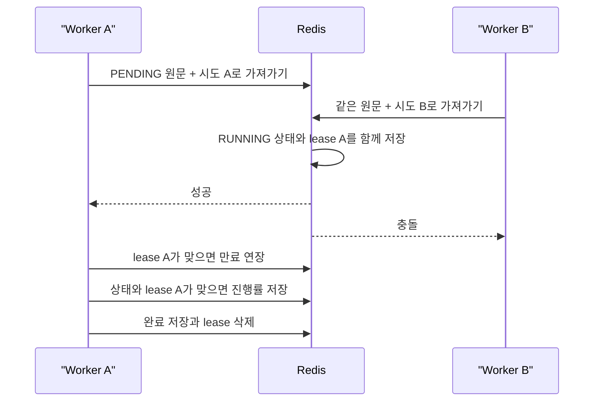

# 문제 수집 worker lease

실행 중인 작업에 "누가 이 작업을 갖고 있는지"를 기록하고, 그 소유자만 진행률과 결과를 쓸 수 있게 바꿨습니다. 다른 서버가 만료된 작업을 넘겨받기 위한 기반입니다.

## 이전과 현재

| 상황 | 이전 | 현재 |
| --- | --- | --- |
| 작업의 실행 주체 | 기록 없음 | 서버 ID, 시도 ID, 시도 번호를 상태와 lease에 저장 |
| 한 항목 처리가 오래 걸릴 때 생존 신호 | 진행률 저장 때만 갱신 | 별도 scheduler가 20초마다 갱신 |
| 소유권이 바뀐 뒤 이전 worker의 진행률·실패·완료 쓰기 | 구분 불가 | 0건 |
| 같은 작업을 두 worker가 동시에 시작 | 상태 비교로 1건만 성공 | 1건만 성공, 소유자 기록 |

응답 시간이나 처리량이 아니라 worker 상태의 정합성을 다룬 변경입니다.

## 문제

[작업 상태 원자 전이](./PHASE_6E_CRAWLER_JOB_STATE_CAS.md)로 같은 작업의 중복 실행은 막았지만, `RUNNING` 작업을 누가 갖고 있는지는 남지 않았습니다.

- 한 항목이 오래 걸리면 진행률을 저장할 때까지 생존 신호가 갱신되지 않았습니다.
- 이전 worker와 새 worker를 구분할 값이 없어서, 만료된 작업을 넘겨받는 기준을 만들 수 없었습니다.
- 취소나 소유자 변경 뒤에 늦게 도착한 진행률을 현재 worker의 기록과 구분할 수 없었습니다.

## 바꾼 내용

### 소유자 기록

worker가 작업을 `RUNNING`으로 가져가면 상태와 짧게 만료되는 lease 키에 같은 정보를 저장합니다.

```json
{ "schemaVersion": 1, "ownerId": "boot-uuid", "attemptId": "claim-uuid", "attemptNumber": 1 }
```

| 필드 | 의미 |
| --- | --- |
| `ownerId` | 서버가 시작할 때 만든 ID |
| `attemptId` | 작업을 가져갈 때마다 만든 ID |
| `attemptNumber` | 같은 작업에서 늘어나는 시도 번호 |

```text
problem:job:status:{jobId}  작업 상태 + 소유자 (24시간)
problem:job:lease:{jobId}   현재 소유자 (lease 시간)
```

상태와 lease의 세 값이 모두 같은 worker만 진행률, 실패 기록, 생존 신호, 완료·실패를 쓸 수 있습니다.

### 가져가기와 갱신



- 가져가기는 상태가 읽은 `PENDING` 원문과 같고 lease가 없을 때만 성공합니다.
- 진행률 저장은 상태와 lease를 모두 비교합니다. 생존 신호 갱신과 겹쳐 충돌하면 다시 읽고 최대 네 번 시도하고, 끝내 저장하지 못하면 다음 항목을 처리하지 않고 소유권을 내려놓습니다.
- 완료, 실패, 관리자 취소는 상태 변경과 lease 삭제를 Lua 하나에서 처리합니다. 늦게 끝난 worker는 자기 lease가 아니면 지우지 못합니다.

기본값은 lease 90초, 생존 신호 20초이고, lease가 생존 신호 간격의 세 배 이상인지 시작 시 검사합니다.

### 설정

```yaml
app:
  problem-collector:
    worker-lease:
      enabled: false
      lease-duration: 90s
      heartbeat-interval: 20s
```

기본값은 꺼져 있습니다. [재시작 고아 작업 정리](./PHASE_6K_CRAWLER_STARTUP_ORPHAN_RECOVERY.md)와 함께 켜면 시작하는 서버가 다른 서버의 정상 작업을 실패로 만들 수 있어서, 두 설정을 같이 켜면 시작을 거절합니다.

## 확인한 방법

로컬 Redis 7.2.5의 별도 DB와 MockK 단위 테스트로 확인했습니다.

| 조건 | 결과 |
| --- | --- |
| 두 worker가 같은 작업을 동시에 가져가기 | 성공 1건, 외부 호출·저장 각 1건 |
| 처리 2.6초, lease 2초, 생존 신호 0.4초 | lease 만료 0건 |
| 생존 신호와 실패 진행률이 겹침 | 재시도로 저장 성공, 실패 기록 1건 |
| lease를 새 시도로 바꿈 | 이전 worker의 진행률·실패·완료 0건 |
| 실행 중 관리자 취소 | `CANCELLED` 유지, 늦은 쓰기 0건 |
| 진행률 충돌 네 번 | 다음 항목 호출 0건, 불완전한 완료 0건 |

전용 MongoDB 7.0.16·Redis 7.2.5에 연결한 `./gradlew clean check`가 통과했습니다. 단위 테스트는 745건에서 750건으로, 통합 테스트는 241건에서 252건으로 늘었습니다.

## 남은 한계

- 이 단계에는 만료된 작업을 찾아 넘겨받는 기능이 없어서 운영 설정은 켜지 않았습니다. [만료 작업 자동 인계](./PHASE_6M_B_CRAWLER_WORKER_TAKEOVER.md)에서 더했습니다.
- 소유권 검사는 Redis 쓰기에만 적용됩니다. 취소나 소유자 변경 전에 시작한 외부 호출과 MongoDB 쓰기 한 건은 끝날 수 있습니다.
- 이전 버전 worker는 소유자 필드를 지울 수 있어서 섞어 돌리지 않습니다.
