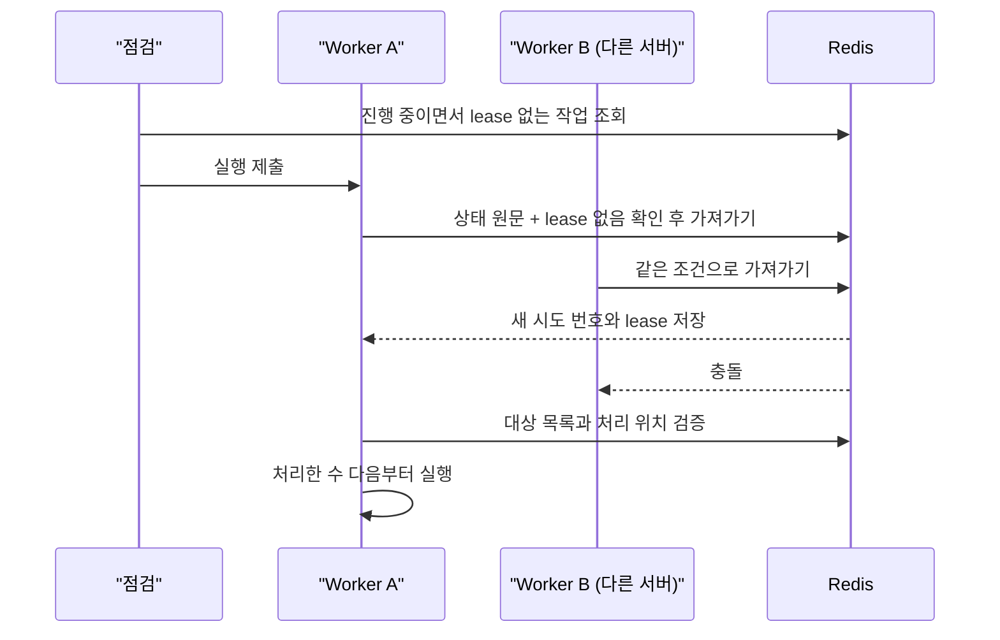

# 문제 수집 만료 작업 자동 인계

실행 주체가 사라진 작업을 다른 worker가 넘겨받아, 이미 처리한 문제 다음부터 이어서 실행하도록 바꿨습니다.

## 이전과 현재

| 상황 | 이전 | 현재 |
| --- | --- | --- |
| 실행기가 거부한 `PENDING` 작업 | 다시 제출되지 않음 | 다음 점검(10초)에서 다시 제출해 완료 |
| worker가 죽어 lease가 사라진 `RUNNING` 작업 | 같은 작업 안에서 이어지지 않음 | 시도 번호를 올려 남은 대상부터 실행 |
| 이미 처리한 앞부분 | 처음부터 다시 실행할 위험 | 다시 호출 0건, 기존 성공·실패 수 유지 |
| 두 서버가 같은 작업을 동시에 넘겨받기 | - | 1건만 성공, 외부 호출 1건 |
| 대상 목록이 없거나 손상된 작업 | - | 외부 호출 없이 실패로 종료 |

응답 시간이나 처리량이 아니라 작업 정합성을 다룬 변경입니다.

## 문제

[worker lease](./PHASE_6M_A_CRAWLER_WORKER_LEASE.md)로 현재 소유자만 상태를 쓰게 했지만, 소유자가 사라진 작업을 다시 실행할 주체가 없었습니다.

- 실행기가 받지 못한 `PENDING` 작업은 다시 제출되지 않았습니다.
- worker가 멈춰 lease가 만료된 `RUNNING` 작업은 그대로 남았습니다.
- 새 worker가 처음부터 다시 실행하면 이미 처리한 외부 호출과 집계가 중복될 수 있었습니다.

## 바꾼 내용

### 점검과 넘겨받기

10초마다 진행 중인 작업 중 lease가 없는 것을 찾아 실행기에 제출합니다. 실제 소유권은 실행이 시작된 뒤 Redis Lua가 정합니다. 실행기 대기열에서 기다리는 동안 lease가 만료되는 일을 피하려고, 제출 전에는 소유권을 잡지 않습니다.



같은 서버에서는 같은 작업을 두 번 제출하지 않고, 서버가 여럿이면 Lua에서 하나만 성공합니다.

### 이어 실행하기 전 검증

소유권을 얻은 뒤 처리 수, 성공·실패 합계, checkpoint 위치, 실패 기록 수, 대상 목록의 해시를 확인합니다.

- 대상 목록이 없으면 외부 호출 없이 `WORKER_UNAVAILABLE`로 끝냅니다.
- 목록이나 진행 상태가 맞지 않으면 외부 호출 없이 `RESOURCE_STATE_CONFLICT`로 끝냅니다.
- 일시적인 Redis 읽기 오류면 실패로 바꾸지 않고 lease를 내려놓아 다음 점검에서 다시 시도합니다.

### 작업 유형별 이어 실행

대상 목록에서 처리한 수만큼 앞부분을 빼고 남은 대상만 처리합니다. 성공·실패 수는 0으로 되돌리지 않고 이어서 셉니다.

| 작업 유형 | 이어 실행 기준 |
| --- | --- |
| 메타데이터 수집 | 남은 ID와 남은 범위를 원래 순서로 |
| 상세 수집 | 남은 ID를 한 번에 조회한 뒤 원래 순서로 |
| 상세 새로고침 | 남은 ID만 BOJ에서 다시 조회 |
| 언어 갱신 | 남은 ID만 조회해 원래 순서로 |

넘겨받기 전에 지워진 문제는 실패 1건으로 기록해, 마지막에 처리 수와 전체 대상 수가 맞도록 합니다.

### 설정

```yaml
app:
  problem-collector:
    worker-lease:
      enabled: false
      lease-duration: 90s
      heartbeat-interval: 20s
      scan-interval: 10s
```

## 확인한 방법

Docker로 띄운 Redis 7.2.5의 별도 DB에서 확인했고, solved.ac·BOJ 호출과 MongoDB 저장 횟수는 MockK로 셌습니다.

| 조건 | 결과 |
| --- | --- |
| 실행기가 첫 제출을 거부 | 상태 변경 0건, 다음 점검에서 완료 |
| 같은 서버에서 점검 반복 | 대기 중인 실행 1건 |
| 두 서버가 같은 만료 작업을 넘겨받기 | 시도 번호 증가 1회, 남은 대상 호출 1건 |
| 메타데이터 작업의 처리한 앞부분 | 다시 호출 0건, 집계 유지 |
| 상세·새로고침·언어의 남은 대상 | DB 전체 조회 0건, 순서 유지 |
| lease가 살아 있는 작업 | 제출 0건, 상태 변경 0건 |
| 대상 목록 없음·해시 불일치 | 외부 호출 0건, 실패로 종료 |

전용 MongoDB 7.0.16·Redis 7.2.5에 연결한 `./gradlew clean check`가 통과했습니다. 단위 테스트는 750건에서 753건으로, 통합 테스트는 252건에서 267건으로 늘었습니다.

## 남은 한계

- 보호 범위는 Redis 작업 상태와 실패 기록입니다. lease가 만료되기 전에 시작한 외부 호출이나 MongoDB 쓰기 한 건은 끝날 수 있고, 새 worker가 같은 항목을 다시 처리할 수 있습니다.
- 점검은 작업 목록 전체를 읽습니다. 작업이 아주 많아지면 진행 중인 작업만 담는 목록이 따로 필요할 수 있습니다.
- 이전 버전 worker와 섞어 돌리지 않습니다.
