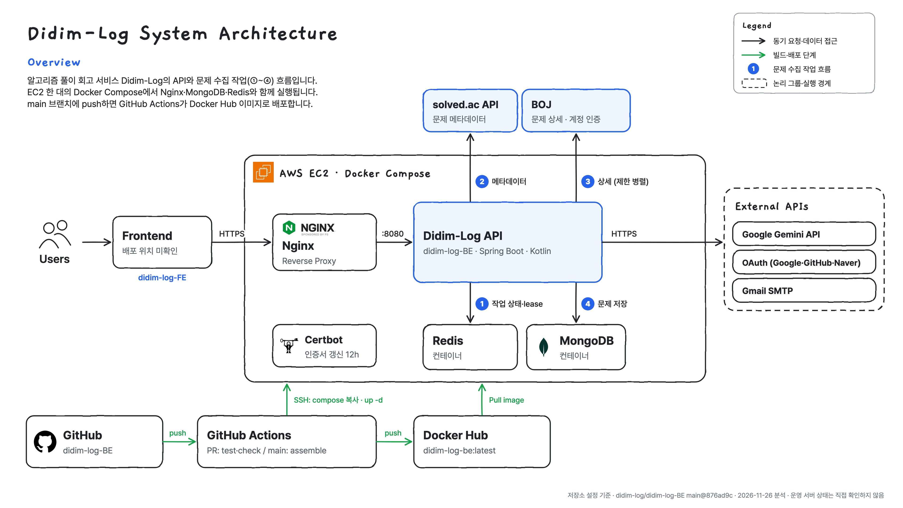
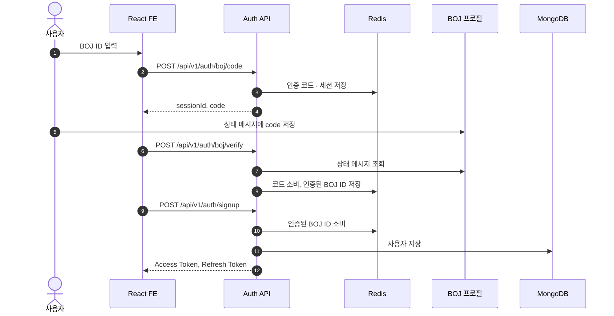
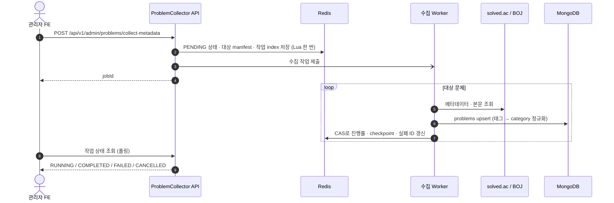
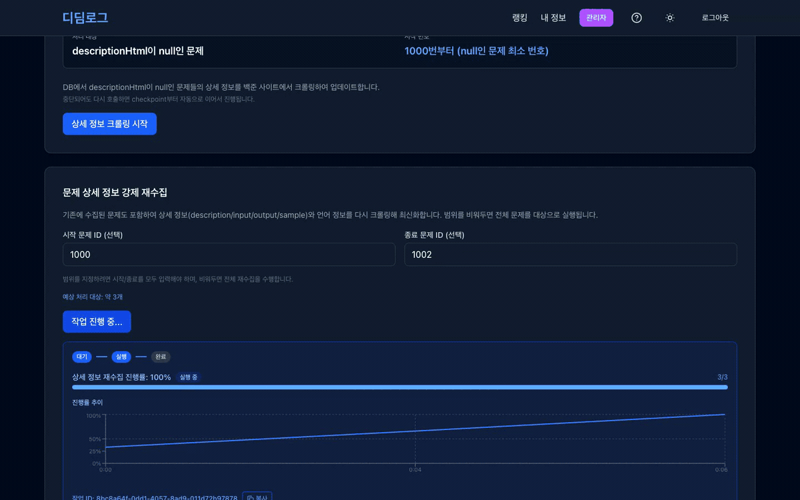
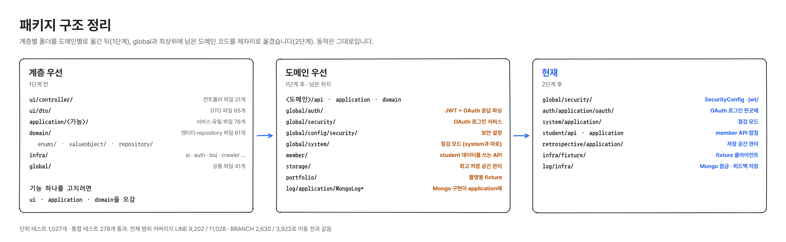

<div align="center">

# DidimLog Backend

알고리즘 풀이 기록·회고·통계를 한곳에 남기는 학습 기록 API

</div>

> 풀이 결과, 소요 시간, 코드, 회고를 하나의 학습 기록으로 저장합니다. 문제 메타데이터와 본문은 solved.ac·BOJ에서 별도 수집 작업으로 가져오고, 사용자 기록은 MongoDB 문서로 저장해 통계와 검색에 씁니다.

| 항목 | 내용 |
| :-- | :-- |
| 기간·인원 | 2026.02 ~ 진행 중, 백엔드 1명 |
| 담당 | 도메인·API 설계, 인증/인가, 문제 수집, 풀이 기록, 회고, AI 리뷰, 운영 도구 |
| 결과 | 단위 테스트 1,027개·통합 테스트 278개. 로컬 fixture 기준 문제 상세 수집 55.6초 → 12.2초 ([측정 결과](#측정-결과)) |
| Frontend | [didim-log/didim-log-FE](https://github.com/didim-log/didim-log-FE) |

## 전체 구조



EC2 한 대의 Docker Compose에서 Nginx, Spring Boot API, MongoDB, Redis가 함께 실행됩니다. 문제 수집 작업은 API가 Redis에 작업 상태를 만들고(①) solved.ac 메타데이터(②)와 BOJ 본문(③)을 가져와 MongoDB에 저장합니다(④). `main`에 push하면 GitHub Actions가 Docker Hub 이미지를 만들고 SSH로 EC2에 배포합니다. 근거와 확인하지 못한 부분은 [아키텍처 문서](./architecture/architecture.md)에 있습니다.

| 도메인 | 맡은 일 |
| :-- | :-- |
| `auth` | BOJ 프로필 상태 메시지로 계정 소유권 확인, JWT 발급·교체, 기존 연결 계정 OAuth 로그인, 요청 제한 |
| `problem` | solved.ac 메타데이터·BOJ 본문 수집 작업, 카테고리 정규화와 계층 검색, 문제 추천 |
| `study` · `log` · `retrospective` | 풀이 결과 누적, 코드를 포함한 코딩 로그, 문제별 회고 작성·검색 |
| `ai` | Gemini 기반 코드 리뷰, 호출 제한과 사용량 예약 |
| `student` · `statistics` · `ranking` | 회원 정보·닉네임·온보딩, 풀이 통계와 히트맵, 랭킹 |
| `admin` · `system` | 회원·피드백 관리, 대시보드 차트, 점검 모드 |
| `global` | 보안 설정과 JWT 필터, 공통 예외 응답, 요청 제한 인터셉터 |

## BOJ 계정 인증과 회원가입

회원가입 전에 서버가 발급한 코드를 BOJ 프로필 상태 메시지에서 확인합니다. 확인한 BOJ ID는 가입 요청에서 한 번만 쓸 수 있습니다.



[BOJ 인증과 회원가입 상세 흐름](./DOCS/portfolio/BOJ_SIGNUP_FLOW.md)

## 문제 수집 작업

관리자가 수집을 요청하면 API는 작업만 만들고 바로 `jobId`를 돌려줍니다. 실제 수집은 별도 executor에서 실행되고, 진행률·checkpoint·실패한 문제 ID는 Redis에 남습니다.



본문 수집(`collect-details`)도 같은 구조입니다. 끝난 작업은 실패한 항목만 다시 실행할 수 있고, 서버가 다시 시작되면 실행 주체를 잃은 작업을 정리합니다. [문제 수집과 카테고리 처리 상세 흐름](./DOCS/portfolio/PROBLEM_COLLECTION_AND_CATEGORY.md)

풀이 결과·코딩 로그·회고 저장은 [풀이 기록 흐름](./DOCS/portfolio/STUDY_RECORD_FLOW.md)에 있습니다.

## 핵심 코드

### 1. 인증 코드와 BOJ ID를 한 번만 쓰기

[`auth/application/boj/BojOwnershipVerificationService.kt`](./src/main/kotlin/com/didimlog/auth/application/boj/BojOwnershipVerificationService.kt#L90-L119)

```kotlin
val statusMessage = fetchStatusMessageOrThrow(bojIdVo)
if (!codeMatcher.matches(statusMessage, verificationCode)) {
    throw BusinessException(ErrorCode.COMMON_INVALID_INPUT, /* ... */)
}

val claimedCode = codeStore.consume(sessionId)
if (claimedCode != storedCode) {
    throw BusinessException(ErrorCode.COMMON_INVALID_INPUT, "인증 코드가 만료되었거나 이미 사용되었습니다.")
}
codeStore.save(VERIFIED_BOJ_ID_KEY_PREFIX + sessionId, bojIdVo.value, DEFAULT_TTL_SECONDS)
```

상태 메시지에 코드가 있어도 Redis에서 코드를 꺼내 지운 요청만 통과합니다. 같은 코드로 두 번 인증하거나, 다른 사람이 인증한 BOJ ID로 가입할 수 없습니다. 가입 때도 인증된 BOJ ID를 같은 방식으로 한 번만 소비합니다.

### 2. AI 리뷰 중복 생성 막기

[`log/infra/MongoLogAiReviewLockRepository.kt`](./src/main/kotlin/com/didimlog/log/infra/MongoLogAiReviewLockRepository.kt#L21-L39)

```kotlin
query.addCriteria(Criteria.where(ID_FIELD).`is`(logId))
query.addCriteria(Criteria.where(AI_REVIEW_FIELD).`is`(null))
query.addCriteria(lockAvailableCriteria(now))

val update = Update()
    .set(AI_REVIEW_STATUS_FIELD, AiReviewStatus.IN_PROGRESS)
    .set(AI_REVIEW_LOCK_EXPIRES_AT_FIELD, expiresAt)
    .inc(AI_REVIEW_LOCK_VERSION_FIELD, 1)

val updated = mongoTemplate.findAndModify(query, update, options, Log::class.java)
```

리뷰가 없고 잠금이 비었거나 만료된 로그만 `IN_PROGRESS`로 바꿉니다. MongoDB가 한 문서에 대해 조건 확인과 갱신을 한 번에 하므로 동시에 50건이 와도 Gemini 호출은 1번입니다. 잠금 버전을 올려 두어, 만료 뒤 늦게 끝난 요청이 새 요청의 결과를 덮어쓰지 못합니다.

### 3. 수집 작업 상태를 비교 후 갱신

[`problem/application/collector/ProblemJobStateStore.kt`](./src/main/kotlin/com/didimlog/problem/application/collector/ProblemJobStateStore.kt#L147-L178) · [Lua 스크립트](./src/main/kotlin/com/didimlog/problem/application/collector/ProblemJobRedisScripts.kt#L44)

```lua
local current = redis.call('GET', KEYS[1])
if not current then
    return -1
end
if current ~= ARGV[1] then
    return 0
end
```

worker가 읽은 상태 JSON이 Redis의 현재 값과 같을 때만 새 상태를 씁니다. 관리자가 취소한 뒤 worker가 진행률을 덮어쓰거나, 끝난 작업이 다시 `RUNNING`이 되는 경우를 막습니다. 실패한 문제 ID 기록과 TTL 갱신도 같은 스크립트 안에서 처리합니다.

### 4. 제한 병렬 수집과 순서 유지

[`problem/application/collector/ParallelProblemDetailsFetcher.kt`](./src/main/kotlin/com/didimlog/problem/application/collector/ParallelProblemDetailsFetcher.kt#L48-L114)

BOJ 본문 조회만 전용 executor에서 최대 `K`개씩 실행하고, 결과는 대상 순서대로 하나씩 꺼내 MongoDB와 Redis에 반영합니다. 순서대로 반영하므로 checkpoint 앞의 문제는 모두 처리된 상태입니다. 기본값은 병렬 끔(`K=1`)입니다.

## 화면

대표 이미지를 누르면 원본 GIF가 열립니다. 외부 BOJ·solved.ac 응답은 `portfolio-fixture` 고정값이고, 화면은 React FE가 로컬 API·Redis·MongoDB를 호출한 결과입니다.

<table>
  <tr>
    <td width="50%" align="center">
      <strong>BOJ 소유권 확인과 회원가입</strong><br /><br />
      <a href="./DOCS/assets/portfolio/01-boj-signup_demo.gif">
        
      </a>
    </td>
    <td width="50%" align="center">
      <strong>비동기 문제 수집 상태</strong><br /><br />
      <a href="./DOCS/assets/portfolio/02-crawler-pipeline_demo.gif">
        
      </a>
    </td>
  </tr>
</table>

<details>
<summary>나머지 화면 2개</summary>

- [풀이 결과 → 코드 로그 → 회고 저장·조회](./DOCS/assets/portfolio/03-problem-solve-save_demo.gif)
- [solved.ac 태그 정규화 → 카테고리 계층 검색](./DOCS/assets/portfolio/04-category-metadata-pipeline_demo.gif)

</details>

## 측정 결과

로컬 MongoDB 7.0.16·Redis 7.2.5 fixture에서 같은 조건으로 변경 전·후를 비교한 값입니다. 운영 처리량이나 응답 시간 개선율이 아닙니다. 조건 전체는 [로컬 검증 결과 상세](./DOCS/LOCAL_VERIFICATION.md)에 있습니다.

| 항목 | 고정 조건 | 이전 | 현재 |
| :-- | :-- | --: | --: |
| 문제 상세 제한 병렬 수집 | 3,400건·10ms 고정 지연·3회 중앙값 | 55.632초 | 12.226초 (누락·중복 0건) |
| 관리자 회원 조회 N+1 제거 | 회원 12명·페이지 크기 10 | 읽기 명령 11 | 2 |
| 통계 조회 데이터 축소 | 회고 1,200건 | 5,230,680 B | 107,790 B |
| 추천 카테고리 조회 단일화 | BFS·RELATED | `problems` find 31 | 1 |
| 수집 작업 목록 일괄 조회 | index 작업 20건 | Redis 명령 21 | 2 |
| AI 리뷰 중복 생성 | 동일 로그 50건 동시 요청·10회 | - | Gemini 호출 1회·저장 1건 |

## 패키지 구조 정리



처음에는 `ui`·`application`·`domain`처럼 계층별로 폴더를 나눠, 기능 하나를 고치려면 여러 폴더를 오가야 했습니다. 2026-11-27에 도메인별 `api`·`application`·`domain`·`infra`로 옮긴 뒤, `global`과 최상위에 남은 OAuth 로그인·점검 모드·회원 API·fixture 코드를 각 도메인으로 옮겼습니다. 클래스 이름, API 경로, 동작은 그대로이고 전체 범위 커버리지 숫자도 이동 전과 같습니다. 이동 내용과 남겨둔 의존은 [패키지 구조 정리](./DOCS/refactoring/PACKAGE_STRUCTURE.md)에 있습니다.

## 테스트

```bash
./gradlew test integrationTest
./gradlew jacocoTestReport jacocoIntegrationTestReport jacocoMergedReport
```

| 항목 | 값 (2026-11-27) |
| :-- | :-- |
| 단위 테스트 | 1,027 passed |
| 통합 테스트 | 278 passed, 10 skipped (로컬 MongoDB·Redis 필요) |
| 전체 범위 커버리지 (단위 테스트) | LINE 83.44% (9,202 / 11,028) · BRANCH 67.06% |
| core 범위 커버리지 (단위 테스트) | LINE 92.05% · BRANCH 76.79% |

PR에서는 GitHub Actions가 MongoDB 7.0.16·Redis 서비스 컨테이너를 띄우고 단위 테스트와 `check`(통합 테스트·커버리지)를 실행합니다.

## 실행

MongoDB·Redis 연결 정보, JWT Secret, OAuth·메일 설정, Swagger 계정을 환경 변수로 준비합니다. Swagger 계정은 기본값이 없습니다.

```bash
export SWAGGER_USERNAME=local-swagger
export SWAGGER_PASSWORD='replace-with-a-long-local-password'
./gradlew bootRun

# 외부 BOJ·solved.ac 대신 고정 응답을 쓰는 촬영용 프로필 (prod와 함께 켜지지 않음)
SPRING_PROFILES_ACTIVE=portfolio-fixture ./gradlew bootRun
```

| 환경 변수 | 기본값 | 사용 기준 |
| :-- | :-- | :-- |
| `PROBLEM_COLLECTOR_FAIL_ORPHANED_JOBS_ON_STARTUP` | `false` | BE가 하나인 기본 Docker Compose에서만 `true` |
| `PROBLEM_COLLECTOR_WORKER_LEASE_ENABLED` | `false` | 같은 항목의 중복 MongoDB 쓰기를 허용할 수 있는 환경에서만 켬. 위 설정과 동시에 켤 수 없음 |

## 한계

| 항목 | 현재 상태 |
| :-- | :-- |
| 채점 | 온라인 채점 시스템이 아님. 풀이 성공 여부와 소요 시간은 사용자가 제출한 값 |
| BOJ 인증 | 공개 프로필 HTML에 의존. BOJ 구조가 바뀌면 파서를 고쳐야 함 |
| OAuth | 이미 연결한 계정의 로그인만 지원, 신규 소셜 가입은 없음 |
| 데모 데이터 | 화면의 외부 응답은 고정 fixture라 실제 외부 연동 성공을 증명하지 않음 |
| 수집 작업 | manifest는 문제 ID와 순서만 고정. worker lease는 Redis 상태만 보호하고, 요청 간격 제한은 JVM 하나 안에서만 공유. 취소해도 이미 시작한 최대 `K`개 요청은 끝까지 갈 수 있음 |

## 기술 스택

| 영역 | 기술 |
| :-- | :-- |
| Language·Framework | Kotlin 1.9.25, Java 17, Spring Boot 3.3.5 (MVC, Security, WebClient) |
| Data | MongoDB, Redis (토큰·요청 제한·수집 작업 상태) |
| External | solved.ac API, BOJ, Google Gemini, OAuth2 (Google·GitHub·Naver), Gmail SMTP |
| Infra | Docker Compose, Nginx, Certbot, GitHub Actions, Docker Hub, AWS EC2 |
| Test | JUnit 5, MockK, JaCoCo |

## 문서

| 분류 | 문서 |
| --- | --- |
| 흐름·검증 | [BOJ 인증과 회원가입 흐름](./DOCS/portfolio/BOJ_SIGNUP_FLOW.md) · [문제 수집과 카테고리 처리](./DOCS/portfolio/PROBLEM_COLLECTION_AND_CATEGORY.md) · [풀이 결과·로그·회고 저장 흐름](./DOCS/portfolio/STUDY_RECORD_FLOW.md) · [API 명세](./DOCS/API_SPECIFICATION.md) · [로컬 검증 결과 상세](./DOCS/LOCAL_VERIFICATION.md) · [로컬 동시성·요청 제한 검증 기록](./DOCS/performance/runs/2026-06-21-DIDIMLOG-LOCAL-VERIFICATION.md) |
| 구조 | [아키텍처와 근거](./architecture/architecture.md) · [패키지 구조 정리](./DOCS/refactoring/PACKAGE_STRUCTURE.md) |
| 조회 최적화 | [관리자 회원 조회 최적화](./DOCS/refactoring/be-refactor/ADMIN_QUERY_OPTIMIZATION_OVERVIEW.md) · [통계 조회 데이터 축소](./DOCS/refactoring/be-refactor/PHASE_4A_STATISTICS_QUERY_OPTIMIZATION.md) · [관리자 대시보드 차트 집계](./DOCS/refactoring/be-refactor/PHASE_6F_ADMIN_DASHBOARD_CHART_AGGREGATION.md) · [추천 카테고리 단일 조회](./DOCS/refactoring/be-refactor/PHASE_6G_RECOMMENDATION_SINGLE_QUERY.md) · [관리자 피드백 작성자 일괄 조회](./DOCS/refactoring/be-refactor/PHASE_6I_ADMIN_FEEDBACK_BATCH_LOOKUP.md) · [문제 수집 작업 목록 일괄 조회](./DOCS/refactoring/be-refactor/PHASE_6J_CRAWLER_JOB_LIST_BATCH_READ.md) |
| 인증·AI 원자성 | [인증 요청 제한 원자화](./DOCS/refactoring/be-refactor/PHASE_2D_AUTH_RATE_LIMIT_ATOMICITY.md) · [AI 사용량 원자적 예약](./DOCS/refactoring/be-refactor/PHASE_5A_AI_USAGE_ATOMIC_RESERVATION.md) · [유지보수 설정 원자화](./DOCS/refactoring/be-refactor/PHASE_6B_MAINTENANCE_CONFIG_ATOMICITY.md) · [AI 리뷰 잠금 소유권 분리](./DOCS/refactoring/be-refactor/PHASE_6C_AI_REVIEW_LOCK_OWNERSHIP.md) · [Gemini 호출 제한 원자화](./DOCS/refactoring/be-refactor/PHASE_6D_GEMINI_RATE_LIMIT_ATOMICITY.md) |
| 데이터 정합성 | [풀이 결과 부분 갱신과 충돌 재시도](./DOCS/refactoring/be-refactor/PHASE_3A_STUDY_SOLUTION_CAS.md) · [회고 원자 갱신과 풀이 기록 삭제 정합성](./DOCS/refactoring/be-refactor/PHASE_3B_RETROSPECTIVE_ATOMIC_UPDATES.md) · [계정 삭제 경로 통합과 연관 데이터 정리](./DOCS/refactoring/be-refactor/PHASE_3C_ACCOUNT_DELETION_CONSISTENCY.md) · [계정 삭제와 사용자 데이터 쓰기 경합 차단](./DOCS/refactoring/be-refactor/PHASE_3D_ACCOUNT_WRITE_BARRIER.md) · [기본 템플릿 참조 정합성](./DOCS/refactoring/be-refactor/PHASE_3E_TEMPLATE_REFERENCE_CONSISTENCY.md) · [고아 데이터 읽기 전용 점검](./DOCS/refactoring/be-refactor/PHASE_5C_ORPHAN_DATA_READ_ONLY_DRY_RUN.md) |
| 문제 수집 | [문제 메타데이터 부분 갱신](./DOCS/refactoring/be-refactor/PHASE_4B_CRAWLER_METADATA_UPSERT.md) · [문제 상세·언어 부분 갱신](./DOCS/refactoring/be-refactor/PHASE_5B_CRAWLER_DETAIL_PARTIAL_UPDATE.md) · [문제 수집 작업 상태 원자 전이](./DOCS/refactoring/be-refactor/PHASE_6E_CRAWLER_JOB_STATE_CAS.md) · [문제 수집 실패 항목 재시도](./DOCS/refactoring/be-refactor/PHASE_6H_CRAWLER_FAILED_ITEM_RETRY.md) · [문제 수집 재시작 고아 작업 정리](./DOCS/refactoring/be-refactor/PHASE_6K_CRAWLER_STARTUP_ORPHAN_RECOVERY.md) · [문제 수집 대상 manifest](./DOCS/refactoring/be-refactor/PHASE_6L_CRAWLER_TARGET_MANIFEST.md) · [문제 수집 worker lease](./DOCS/refactoring/be-refactor/PHASE_6M_A_CRAWLER_WORKER_LEASE.md) · [문제 수집 만료 작업 자동 인계](./DOCS/refactoring/be-refactor/PHASE_6M_B_CRAWLER_WORKER_TAKEOVER.md) · [문제 상세 제한 병렬 수집](./DOCS/refactoring/be-refactor/PHASE_6N_CRAWLER_DETAILS_BOUNDED_PARALLEL.md) |
| 개발 규칙 | [Clean Code 원칙](./DOCS/CLEAN_CODE_PRINCIPLES.md) · [PR 가이드](./DOCS/PR_GUIDE.md) · [커밋 컨벤션](./DOCS/COMMIT_CONVENTION.md) |
