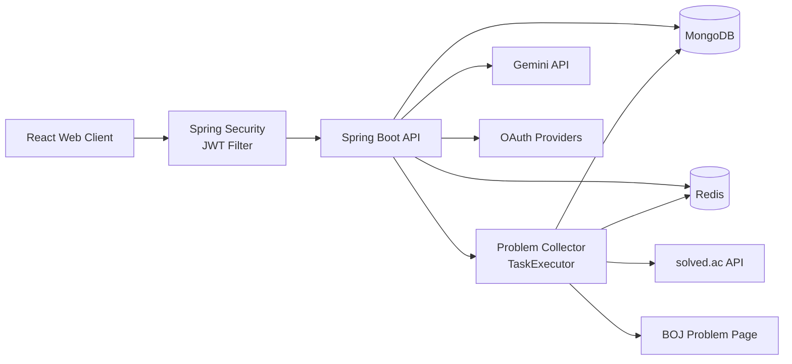
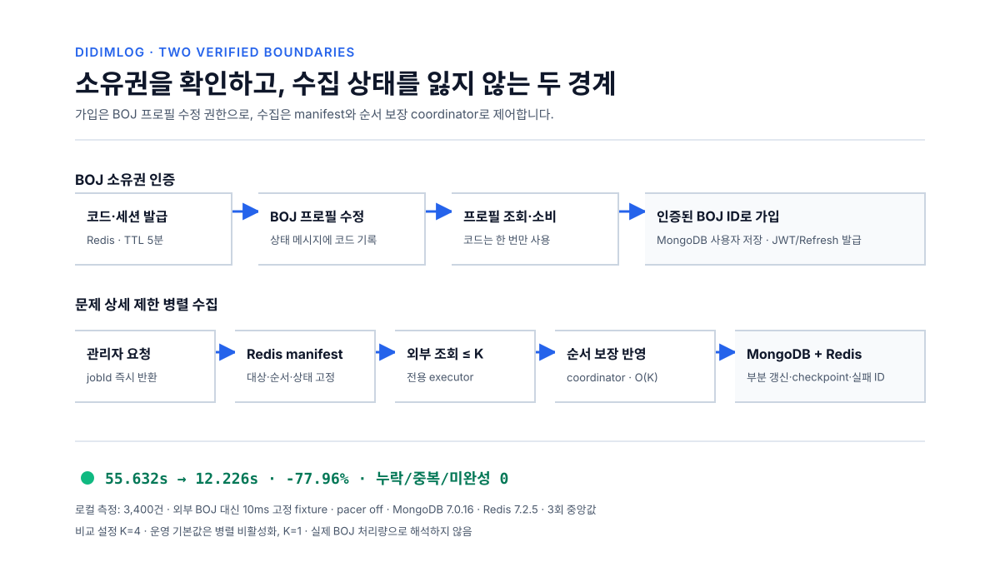
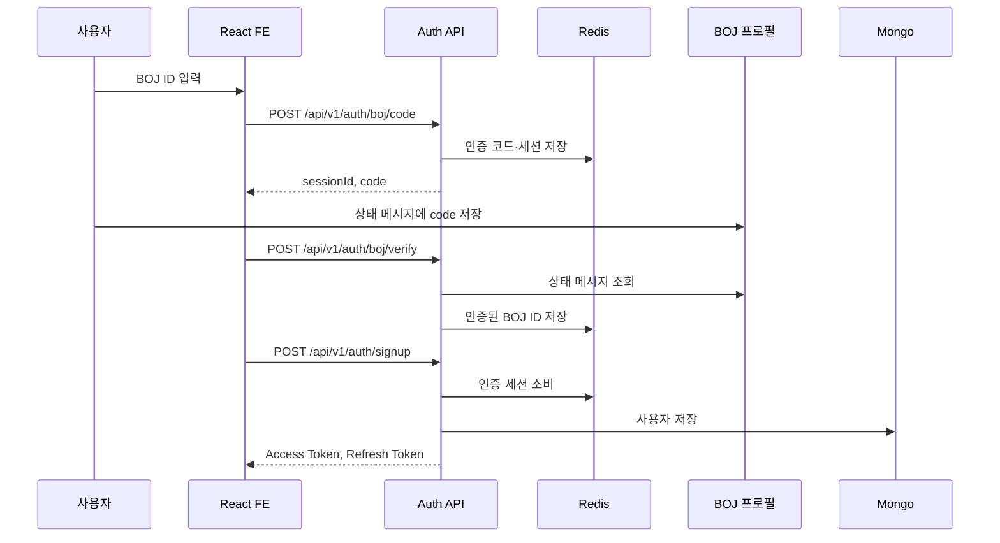
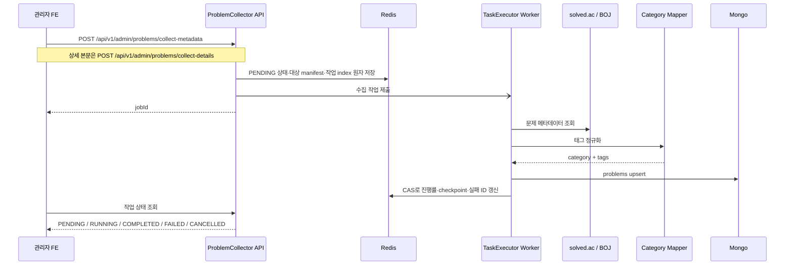
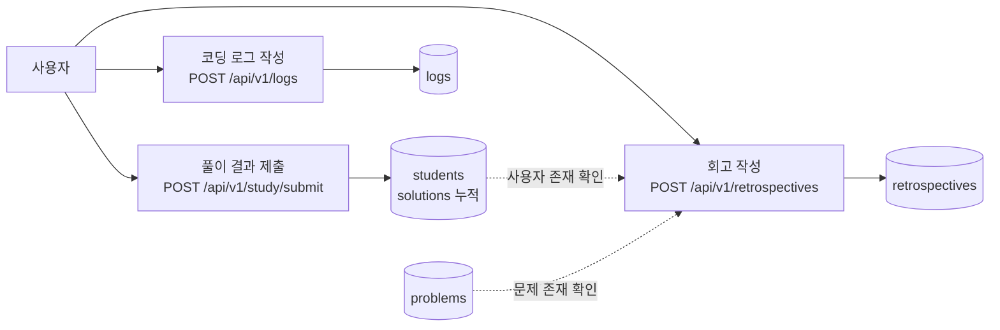
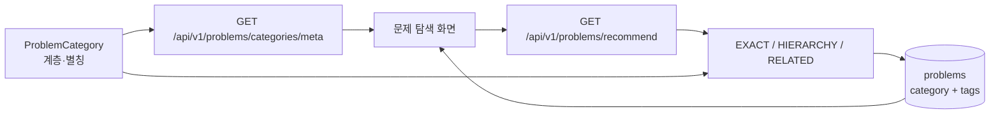
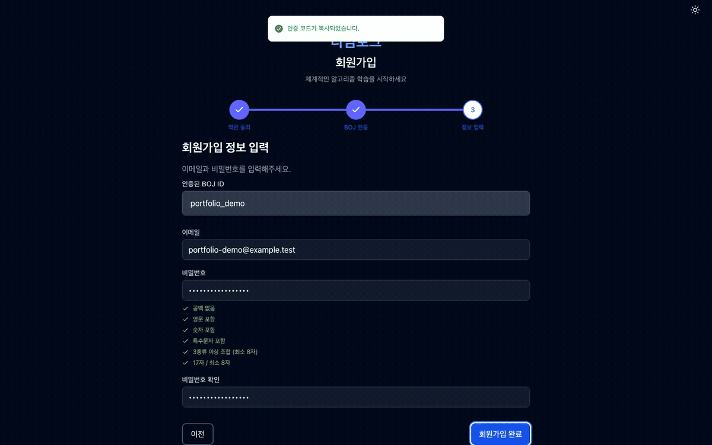

# DidimLog Backend API Server

> 알고리즘 문제 풀이 결과와 코드를 기록하고, 회고·통계·AI 피드백으로 학습 과정을 연결하는 백엔드 서비스입니다.

## 1. 프로젝트 소개

풀이 결과, 소요 시간, 코드, 회고를 하나의 학습 기록으로 남깁니다. 문제 메타데이터와 본문은 별도 수집 파이프라인으로 관리하고, 사용자 기록은 MongoDB 문서로 저장해 통계와 검색에 사용합니다.

| 항목 | 내용 |
| --- | --- |
| 개발 기간 | 2026.02 ~ 진행 중 |
| 개발 인원 | 백엔드 1명 |
| 담당 | 도메인·API 설계, 인증/인가, 문제 수집, 풀이 기록, 회고, AI 리뷰, 운영 도구 |
| Backend | [didim-log/didim-log-BE](https://github.com/didim-log/didim-log-BE) |
| Frontend | [didim-log/didim-log-FE](https://github.com/didim-log/didim-log-FE) |
| 결과 | 로컬 fixture 기준 문제 상세 수집 55.632초 → 12.226초, 통계 조회 데이터 97.94% 감소 ([7. 로컬 검증 결과](#7-로컬-검증-결과)) |

## 2. 기술 스택

| Category | Tech Stack | Version | Decision Reason |
| --- | --- | --- | --- |
| Language | Kotlin | 1.9.25 | Null Safety와 도메인 모델 표현력을 활용해 비즈니스 규칙을 명시적으로 표현 |
| Framework | Spring Boot, Spring MVC, WebClient, Spring Security | 3.3.5 | MVC API, 외부 HTTP 호출, JWT 인증·인가 구성 |
| Database | MongoDB | - | 문제·사용자 풀이·로그·회고처럼 형태가 다른 문서를 유연하게 저장 |
| Cache / State | Redis | - | Refresh Token, Rate Limit, 수집 작업 상태와 TTL 데이터 관리 |
| External | solved.ac, BOJ, Gemini, OAuth2 | - | 문제 메타데이터·본문 수집, AI 피드백, 기존 연결 계정 로그인 |
| Infra | Docker, Docker Compose, AWS EC2, Nginx | - | 실행 환경 표준화와 배포 구성 관리 |

## 3. 시스템 아키텍처



### 설계 기준

- 도메인별 패키지(`auth`, `student`, `problem`, `log`, `retrospective` 등) 아래에 `api`(controller·DTO), `application`(유스케이스·포트), `domain`(엔티티·repository), `infra`(해당 도메인 전용 외부 어댑터)를 두어 유스케이스와 외부 의존성을 분리했습니다. 여러 도메인이 함께 쓰는 외부 어댑터(`infra.solvedac`, `infra.email`)와 공통 설정·보안(`global`)은 최상위에 둡니다.
- 관리자 문제 수집은 요청과 작업 실행을 분리하고, Redis에 진행 상태·성공/실패 수·checkpoint·실패 문제 ID·실제 대상 manifest를 기록합니다.
- worker lease 모드에서는 상태의 attempt와 Redis lease가 같은 worker만 heartbeat·진행률·종료 상태를 갱신합니다.
- lease가 없는 `PENDING`·`RUNNING` 작업은 scanner가 다시 제출하고, 현재 `processedCount` 이후 manifest 대상부터 이어서 실행합니다.
- 문제, 사용자 풀이, 로그, 회고는 목적이 다른 MongoDB 문서로 관리합니다.
- AI 리뷰는 MongoDB `findAndModify` 기반 잠금으로 동일 로그의 중복 생성을 제어합니다.

## 4. 담당 기능과 핵심 구현

| 영역 | 구현 |
| --- | --- |
| 문제 수집·운영 제어 | solved.ac 메타데이터 수집과 MongoDB upsert, BOJ 본문·입력·출력·예제 HTML 수집, 상세 조회 최대 `K`개 제한 병렬 처리, Redis 작업 상태(Lua CAS 전이·TTL·sorted index·heartbeat·checkpoint·실패 원장·대상 manifest), 관리자 작업 목록·취소·재시도·감사 로그·운영 메트릭 API |
| 학습 기록 | 풀이 성공 여부·소요 시간 누적, 제목·본문·코드를 포함한 코딩 로그, 학생·문제 기준 회고 생성·수정, 카테고리·풀이 전략·북마크 기반 회고 검색 |
| 인증 | BOJ 프로필 상태 메시지로 계정 소유권 인증, 불변 학생 ID와 자격 상태 버전을 서명한 Access/Refresh Token(최신 BOJ ID·버전·권한이 모두 같아야 인증), Refresh Token 원자 교체, 기존 연결 계정 OAuth2 로그인, USER / ADMIN 권한 분리 |
| 운영 안정성 | 인증 API Rate Limit, AI 리뷰 잠금·실패 상태 전환·재시도 ([8. 트러블 슈팅](#8-트러블-슈팅)) |

## 5. 핵심 데이터 흐름

<p align="center">
  
</p>

### 5-1. BOJ 계정 인증과 회원가입

회원가입 전에 서버가 발급한 코드를 BOJ 프로필 상태 메시지에서 확인합니다. 인증된 BOJ ID는 가입 요청에서 한 번만 사용할 수 있는 세션에 연결합니다.



[BOJ 인증과 회원가입 상세 흐름](./DOCS/portfolio/BOJ_SIGNUP_FLOW.md)

### 5-2. 문제 메타데이터·본문 수집

메타데이터와 본문은 별도 작업으로 수집합니다. 카테고리는 독립된 크롤러의 결과가 아니라 solved.ac 태그를 수집할 때 함께 정규화한 값입니다.



정규화 단계에서는 한국어 `displayName`을 `ProblemCategory`의 영문 표준명으로 변환합니다. 첫 번째 정규화 태그는 대표 `category`, 전체 태그는 `tags` 배열에 저장합니다.

[문제 수집과 카테고리 처리 상세 흐름](./DOCS/portfolio/PROBLEM_COLLECTION_AND_CATEGORY.md)

### 5-3. 풀이 결과·로그·회고 저장



- 풀이 제출 시 인증 principal의 불변 `studentId`로 사용자를 찾고, 문제 존재 여부를 확인한 뒤 성공 여부와 소요 시간을 사용자 문서에 저장합니다.
- 같은 학생의 동시 제출은 `documentVersion` 조건부 갱신과 최대 3회 재시도로 최신 풀이 기록에 합칩니다.
- 코딩 로그는 불변 `studentId`를 소유자로 두고 제목, 내용, 코드, 생성 시점 BOJ ID, 성공 여부를 별도 문서로 저장합니다.
- AI 리뷰 조회·피드백은 캐시 반환 전에도 인증 principal의 `studentId`와 로그 소유자가 일치하는지 확인합니다.
- 회고는 사용자·문제를 검증한 뒤 문제 카테고리를 함께 저장하고, 원자 upsert 또는 소유자 조건 부분 갱신으로 생성·수정합니다.

[풀이 결과·로그·회고 상세 흐름](./DOCS/portfolio/STUDY_RECORD_FLOW.md)

로그 피드백의 소유권 검증과 거부 조건은 [로그 피드백 소유권 검증](./DOCS/refactoring/be-refactor/PHASE_2C_3_LOG_FEEDBACK_OWNERSHIP.md)에 정리했습니다.

### 5-4. 카테고리 계층 확장 검색

카테고리 계층은 외부 사이트에서 다시 수집하지 않고 애플리케이션에 정의한 부모·자식·연관 관계를 사용합니다.



1. `GET /api/v1/problems/categories/meta`가 정규 이름, 별칭, 부모·자식·연관 카테고리를 제공합니다.
2. `EXACT`는 대표 카테고리를 정확히 비교합니다.
3. `HIERARCHY`는 선택 카테고리와 하위 태그를 확장합니다.
4. `RELATED`는 계층 결과에 부모·형제 관계를 더합니다.
5. MongoDB의 `category`와 `tags`를 조회해 추천 후보를 구성합니다.

[문제 수집과 카테고리 처리 상세 흐름](./DOCS/portfolio/PROBLEM_COLLECTION_AND_CATEGORY.md)

## 6. 화면으로 확인하기

대표 이미지를 선택하면 각 원본 GIF가 열립니다.

<table>
  <tr>
    <td width="50%" align="center">
      <strong>BOJ 소유권 확인과 회원가입</strong><br /><br />
      <a href="./DOCS/assets/portfolio/01-boj-signup_demo.gif">
        
      </a>
    </td>
    <td width="50%" align="center">
      <strong>비동기 문제 수집 상태</strong><br /><br />
      <a href="./DOCS/assets/portfolio/02-crawler-pipeline_demo.gif">
        
      </a>
    </td>
  </tr>
</table>

<details>
<summary>원본 화면 흐름 4개 보기</summary>

- [BOJ 상태 메시지 인증 → 회원가입 → 대시보드](./DOCS/assets/portfolio/01-boj-signup_demo.gif)
- [관리자 비동기 수집 → Redis 작업 상태 → MongoDB 저장](./DOCS/assets/portfolio/02-crawler-pipeline_demo.gif)
- [풀이 결과 → 코드 로그 → 회고 저장·조회](./DOCS/assets/portfolio/03-problem-solve-save_demo.gif)
- [solved.ac 태그 정규화 → 카테고리 계층 확장 검색](./DOCS/assets/portfolio/04-category-metadata-pipeline_demo.gif)

</details>

> 외부 BOJ·solved.ac 응답과 BOJ 인증 코드 생성에는 `portfolio-fixture`의 고정값을 사용했습니다. 화면은 React FE가 로컬 Spring Boot API를 호출하고 Redis와 MongoDB에 저장한 결과입니다.

## 7. 로컬 검증 결과

대표 결과만 남겼습니다. 모든 표와 측정 조건은 [로컬 검증 결과 상세](./DOCS/LOCAL_VERIFICATION.md)에 있습니다.
수치는 로컬 MongoDB 7.0.16·Redis 7.2.5 fixture에서 Before·After를 같은 조건으로 비교한 값이며, 운영 처리량이나 응답 시간 개선율이 아닙니다.

| 항목 | 고정 조건 | Before | After | 변화 |
| --- | --- | ---: | ---: | ---: |
| 문제 상세 제한 병렬 수집 | 3,400건·10ms 고정 지연·3회 중앙값 | 55.632초 | 12.226초 | 77.96% 단축, 누락·중복 0건 |
| 관리자 회원 조회 N+1 제거 | 회원 12명·페이지 크기 10 | 읽기 명령 11 | 2 | 81.8% 감소 |
| 통계 조회 데이터 축소 | 회고 1,200건 | 5,230,680 B | 107,790 B | 97.94% 감소 |
| 추천 카테고리 조회 단일화 | BFS·RELATED | `problems` find 31 | 1 | 96.77% 감소 |
| 수집 작업 목록 일괄 조회 | index 작업 20건 | Redis 명령 21 | 2 | 90.48% 감소 |
| AI 리뷰 중복 생성 | 동일 로그 50건 동시 요청·10회 | - | Gemini 호출 1회·저장 1건 | 중복 0건 |

## 8. 트러블 슈팅

### AI 리뷰 중복 생성 및 동시성 제어

- 문제: 동일 로그에 짧은 시간 동안 요청이 집중되면 AI API 호출과 최종 저장이 중복될 수 있었습니다.
- 해결: MongoDB `findAndModify`로 `IN_PROGRESS` 잠금을 원자적으로 획득하고, 완료·실패 상태와 잠금 만료 시각을 함께 관리했습니다.
- 검증: 동일 로그 동시 요청에서 각 회차의 Gemini 호출과 최종 저장이 1건으로 수렴했습니다([7. 로컬 검증 결과](#7-로컬-검증-결과)).

### 문제 수집 작업의 비동기 실행

- 문제: 같은 클래스의 `private` 메서드에 `@Async`를 적용하면 Spring 프록시를 거치지 않아 수집이 요청 스레드에서 실행되고 응답이 지연될 수 있습니다.
- 해결: 명시적으로 주입한 `TaskExecutor`에 수집 작업을 제출하고, API는 Redis job 생성 후 `jobId`를 반환하도록 분리했습니다.
- 상태 전이: Redis 원본 JSON을 기대값으로 비교하는 Lua CAS로 처리하고, 종료 상태는 다시 변경하지 않습니다. 신규 작업의 상태·대상 manifest·index와 항목 실패 ID도 같은 Lua에서 기록하며, 완료 작업은 실패 항목만 다시 실행합니다. 참조된 manifest가 없거나 손상됐다면 409를 반환합니다.
- 복구: 단일 BE Docker 구성은 시작할 때 작업 생성 gate를 닫고, 실행 주체를 잃은 `PENDING`·`RUNNING` 작업만 `WORKER_UNAVAILABLE`로 실패 처리한 뒤 gate를 엽니다. worker lease 모드는 10초마다 lease가 없는 작업을 다시 제출하고(claim은 Runnable 시작 후 수행), 만료된 `RUNNING` 작업은 기존 카운터와 checkpoint를 유지한 채 manifest suffix만 처리합니다. manifest가 없거나 손상된 작업은 외부 호출 없이 `FAILED` 처리합니다.
- 병렬 처리: 상세 외부 조회만 전용 executor에서 최대 `K`개씩 실행하고, MongoDB·Redis는 coordinator가 manifest 순서로 반영해 연속 checkpoint를 유지합니다. 기본은 병렬 비활성화·`K=1`입니다.
- 결과: 관리자 화면은 상태 API를 폴링하며 진행률과 checkpoint를 갱신하고, 같은 작업의 중복 실행과 취소 뒤 상태 덮어쓰기를 막습니다.

### 인증 API 남용 방지

- Redis Lua 한 번으로 카운터와 최초 만료 시간을 처리해 동시 요청에서도 한도를 넘기지 않습니다.
- Tomcat이 내부 프록시에서 받은 주소만 반영하고 BE 포트는 로컬에만 열며, 로그인 성공으로 제한 횟수를 초기화하지 않습니다.
- 제한 초과 시 남은 횟수, 재시도 대기 시간과 해제 예정 시각을 반환합니다.

## 9. 실행 및 테스트

### 로컬 실행

MongoDB·Redis 연결 정보, JWT Secret, OAuth·메일 설정과 Swagger 전용 계정을 환경 변수로 준비합니다. Swagger 계정은 기본값이 없으므로 `SWAGGER_USERNAME`, `SWAGGER_PASSWORD`를 지정해야 합니다.

```bash
export SWAGGER_USERNAME=local-swagger
export SWAGGER_PASSWORD='replace-with-a-long-local-password'
./gradlew bootRun
```

| 환경 변수 | 기본값 | 사용 기준 |
| --- | --- | --- |
| `PROBLEM_COLLECTOR_FAIL_ORPHANED_JOBS_ON_STARTUP` | `false` | BE가 하나인 기본 Docker Compose에서만 `true`. 여러 BE를 함께 실행하거나 순차 교체할 때는 `false` 유지 |
| `PROBLEM_COLLECTOR_WORKER_LEASE_ENABLED` | `false` | Redis 상태·실패 원장만 보호하고 이미 시작한 MongoDB 쓰기는 차단하지 않으므로, 같은 항목의 중복 쓰기를 허용할 수 있는 환경에서만 활성화. 위 시작 실패 복구와 동시에 켤 수 없음 |

외부 BOJ·solved.ac 응답을 사용하지 않는 포트폴리오 촬영 환경에서는 로컬 전용 프로필을 활성화합니다.

```bash
SPRING_PROFILES_ACTIVE=portfolio-fixture ./gradlew bootRun
```

`portfolio-fixture` 구성은 `prod`와 동시에 활성화될 경우 고정 인증 코드와 외부 fixture 클라이언트가 동작하지 않도록 제한했습니다.

### 테스트

```bash
./gradlew test
./gradlew integrationTest
./gradlew check
./gradlew jacocoTestReport jacocoIntegrationTestReport jacocoMergedReport
```

## 10. 한계와 검증 범위

- DidimLog는 온라인 채점 시스템이 아닙니다. 풀이 성공 여부와 소요 시간은 사용자가 제출한 값을 기록합니다.
- BOJ 계정 인증은 공개 프로필의 상태 메시지 조회에 의존합니다. BOJ HTML 구조가 변경되면 파서를 갱신해야 합니다.
- OAuth2 로그인은 기존 연결 계정에만 제공하며 신규 소셜 가입은 지원하지 않습니다.
- 데모의 외부 BOJ·solved.ac 응답은 고정 fixture이므로 실제 외부 연동 성공을 증명하지 않습니다.
- 문제 수집 대상 manifest는 문제 ID와 순서만 고정하며 당시 문제 문서 내용의 snapshot이나 exactly-once 실행을 보장하지 않습니다.
- 문제 수집 worker lease와 자동 인계는 Redis 상태·실패 원장만 보호합니다. lease 만료 전에 시작한 외부 호출과 MongoDB 쓰기 한 건은 새 worker의 같은 항목 처리와 겹칠 수 있습니다.
- 문제 상세 요청 시작 간격은 하나의 JVM에서만 공유하며, 여러 BE 인스턴스의 합산 요청률을 제한하지는 않습니다.
- 취소는 결과 반영을 막지만 이미 시작된 최대 `K`개의 HTTP 요청을 즉시 종료한다고 보장하지 않습니다.
- 외부 API 계약이 변경되면 클라이언트와 응답 모델을 갱신해야 할 수 있습니다.

## 11. 문서

| 분류 | 문서 |
| --- | --- |
| 흐름·검증 | [BOJ 인증과 회원가입 흐름](./DOCS/portfolio/BOJ_SIGNUP_FLOW.md) · [문제 수집과 카테고리 처리](./DOCS/portfolio/PROBLEM_COLLECTION_AND_CATEGORY.md) · [풀이 결과·로그·회고 저장 흐름](./DOCS/portfolio/STUDY_RECORD_FLOW.md) · [API 명세](./DOCS/API_SPECIFICATION.md) · [로컬 검증 결과 상세](./DOCS/LOCAL_VERIFICATION.md) · [로컬 동시성·요청 제한 검증 기록](./DOCS/performance/runs/2026-06-21-DIDIMLOG-LOCAL-VERIFICATION.md) |
| 조회 최적화 | [관리자 회원 조회 최적화](./DOCS/refactoring/be-refactor/ADMIN_QUERY_OPTIMIZATION_OVERVIEW.md) · [통계 조회 데이터 축소](./DOCS/refactoring/be-refactor/PHASE_4A_STATISTICS_QUERY_OPTIMIZATION.md) · [관리자 대시보드 차트 집계](./DOCS/refactoring/be-refactor/PHASE_6F_ADMIN_DASHBOARD_CHART_AGGREGATION.md) · [추천 카테고리 단일 조회](./DOCS/refactoring/be-refactor/PHASE_6G_RECOMMENDATION_SINGLE_QUERY.md) · [관리자 피드백 작성자 일괄 조회](./DOCS/refactoring/be-refactor/PHASE_6I_ADMIN_FEEDBACK_BATCH_LOOKUP.md) · [문제 수집 작업 목록 일괄 조회](./DOCS/refactoring/be-refactor/PHASE_6J_CRAWLER_JOB_LIST_BATCH_READ.md) |
| 인증·AI 원자성 | [인증 요청 제한 원자화](./DOCS/refactoring/be-refactor/PHASE_2D_AUTH_RATE_LIMIT_ATOMICITY.md) · [AI 사용량 원자적 예약](./DOCS/refactoring/be-refactor/PHASE_5A_AI_USAGE_ATOMIC_RESERVATION.md) · [유지보수 설정 원자화](./DOCS/refactoring/be-refactor/PHASE_6B_MAINTENANCE_CONFIG_ATOMICITY.md) · [AI 리뷰 잠금 소유권 분리](./DOCS/refactoring/be-refactor/PHASE_6C_AI_REVIEW_LOCK_OWNERSHIP.md) · [Gemini 호출 제한 원자화](./DOCS/refactoring/be-refactor/PHASE_6D_GEMINI_RATE_LIMIT_ATOMICITY.md) |
| 데이터 정합성 | [풀이 결과 부분 갱신과 충돌 재시도](./DOCS/refactoring/be-refactor/PHASE_3A_STUDY_SOLUTION_CAS.md) · [회고 원자 갱신과 풀이 기록 삭제 정합성](./DOCS/refactoring/be-refactor/PHASE_3B_RETROSPECTIVE_ATOMIC_UPDATES.md) · [계정 삭제 경로 통합과 연관 데이터 정리](./DOCS/refactoring/be-refactor/PHASE_3C_ACCOUNT_DELETION_CONSISTENCY.md) · [계정 삭제와 사용자 데이터 쓰기 경합 차단](./DOCS/refactoring/be-refactor/PHASE_3D_ACCOUNT_WRITE_BARRIER.md) · [기본 템플릿 참조 정합성](./DOCS/refactoring/be-refactor/PHASE_3E_TEMPLATE_REFERENCE_CONSISTENCY.md) · [고아 데이터 읽기 전용 점검](./DOCS/refactoring/be-refactor/PHASE_5C_ORPHAN_DATA_READ_ONLY_DRY_RUN.md) |
| 문제 수집 | [문제 메타데이터 부분 갱신](./DOCS/refactoring/be-refactor/PHASE_4B_CRAWLER_METADATA_UPSERT.md) · [문제 상세·언어 부분 갱신](./DOCS/refactoring/be-refactor/PHASE_5B_CRAWLER_DETAIL_PARTIAL_UPDATE.md) · [문제 수집 작업 상태 원자 전이](./DOCS/refactoring/be-refactor/PHASE_6E_CRAWLER_JOB_STATE_CAS.md) · [문제 수집 실패 항목 재시도](./DOCS/refactoring/be-refactor/PHASE_6H_CRAWLER_FAILED_ITEM_RETRY.md) · [문제 수집 재시작 고아 작업 정리](./DOCS/refactoring/be-refactor/PHASE_6K_CRAWLER_STARTUP_ORPHAN_RECOVERY.md) · [문제 수집 대상 manifest](./DOCS/refactoring/be-refactor/PHASE_6L_CRAWLER_TARGET_MANIFEST.md) · [문제 수집 worker lease](./DOCS/refactoring/be-refactor/PHASE_6M_A_CRAWLER_WORKER_LEASE.md) · [문제 수집 만료 작업 자동 인계](./DOCS/refactoring/be-refactor/PHASE_6M_B_CRAWLER_WORKER_TAKEOVER.md) · [문제 상세 제한 병렬 수집](./DOCS/refactoring/be-refactor/PHASE_6N_CRAWLER_DETAILS_BOUNDED_PARALLEL.md) |
| 개발 규칙 | [Clean Code 원칙](./DOCS/CLEAN_CODE_PRINCIPLES.md) · [PR 가이드](./DOCS/PR_GUIDE.md) · [커밋 컨벤션](./DOCS/COMMIT_CONVENTION.md) |
