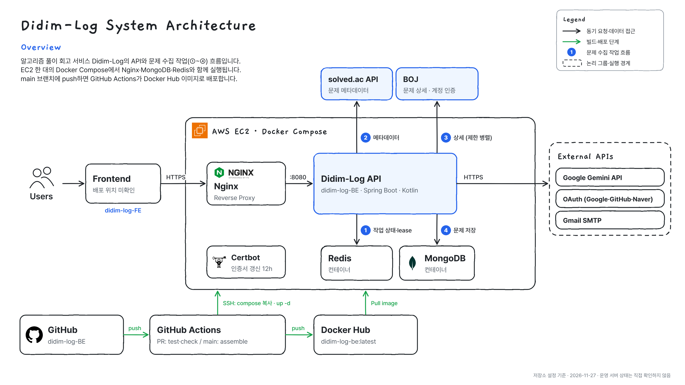

# Didim-Log System Architecture

[SVG 원본](./architecture.svg)

## 구조 요약

- 알고리즘 풀이 회고 서비스의 백엔드는 Spring Boot(Kotlin) 애플리케이션 하나입니다.
- 운영 배포 설정은 EC2 한 대의 Docker Compose로 Nginx, Certbot, API, MongoDB, Redis 컨테이너를 함께 띄웁니다.
- API는 solved.ac API, BOJ, Google Gemini API, OAuth 2.0 제공자(Google·GitHub·Naver), Gmail SMTP를 호출합니다.
- `main`에 push하면 GitHub Actions가 JAR와 Docker 이미지를 만들어 Docker Hub에 올리고, SSH로 EC2에서 `docker-compose pull`·`up -d`를 실행합니다.

## 조사 기준

| 항목 | 값 |
| --- | --- |
| 분석일 | 2026-11-26 |
| 저장소 | [didim-log/didim-log-BE](https://github.com/didim-log/didim-log-BE) |
| 확인한 커밋 | `main` [`876ad9c`](https://github.com/didim-log/didim-log-BE/commit/876ad9c3028f85941425ae30d9d1980a185873d6) |
| 대상 환경 | `deploy.yml`이 배포하는 운영 구성 (저장소 설정 기준) |
| 운영 서버 | 직접 확인하지 않음 |
| 경로 변경 | 근거 링크는 `876ad9c` 시점 경로입니다. 이후 패키지 정리로 `infra/crawler`·`infra/boj`·`infra/ai`는 `problem/infra/crawler`·`auth/infra/boj`·`ai/infra`로 옮겼고, 구성요소와 연결은 같습니다. 이동 내용은 [패키지 구조 정리](../DOCS/refactoring/PACKAGE_STRUCTURE.md)에 있습니다. |

## 근거표

`B` = `https://github.com/didim-log/didim-log-BE/blob/876ad9c3028f85941425ae30d9d1980a185873d6`

| 도면의 구성요소·연결·경계 | 의미 | 근거 | 환경 | 확인 상태 |
| --- | --- | --- | --- | --- |
| AWS EC2 · Docker Compose | 배포 대상 호스트와 컨테이너 묶음 | [deploy.yml L104-L176](https://github.com/didim-log/didim-log-BE/blob/876ad9c3028f85941425ae30d9d1980a185873d6/.github/workflows/deploy.yml#L104-L176) (`AWS_HOST`로 scp·ssh), [docker-compose.yml](https://github.com/didim-log/didim-log-BE/blob/876ad9c3028f85941425ae30d9d1980a185873d6/docker-compose.yml) | 운영 | 코드·설정 확인 |
| Nginx | 80 포트로 받아 API 8080으로 프록시 | [docker-compose.yml L36-L52](https://github.com/didim-log/didim-log-BE/blob/876ad9c3028f85941425ae30d9d1980a185873d6/docker-compose.yml#L36-L52), [didim-log.conf L1-L23](https://github.com/didim-log/didim-log-BE/blob/876ad9c3028f85941425ae30d9d1980a185873d6/nginx/conf.d/didim-log.conf#L1-L23) | 운영 | 코드·설정 확인 |
| Certbot | 인증서를 12시간마다 갱신, Nginx와 인증서 볼륨 공유 | [docker-compose.yml L53-L61](https://github.com/didim-log/didim-log-BE/blob/876ad9c3028f85941425ae30d9d1980a185873d6/docker-compose.yml#L53-L61) | 운영 | 코드·설정 확인 |
| Didim-Log API | Spring Boot · Kotlin 애플리케이션 | [build.gradle.kts L1-L9](https://github.com/didim-log/didim-log-BE/blob/876ad9c3028f85941425ae30d9d1980a185873d6/build.gradle.kts#L1-L9), [docker-compose.yml L2-L16](https://github.com/didim-log/didim-log-BE/blob/876ad9c3028f85941425ae30d9d1980a185873d6/docker-compose.yml#L2-L16) | 운영 | 코드·설정 확인 |
| API → MongoDB | 회원·문제·회고 저장 | [build.gradle.kts L82](https://github.com/didim-log/didim-log-BE/blob/876ad9c3028f85941425ae30d9d1980a185873d6/build.gradle.kts#L82), [docker-compose.yml L18-L25](https://github.com/didim-log/didim-log-BE/blob/876ad9c3028f85941425ae30d9d1980a185873d6/docker-compose.yml#L18-L25) (`depends_on`) | 운영 | 코드·설정 확인 (연결 URI는 비밀값이라 값 자체는 미확인) |
| API → Redis | 토큰·요청 제한·수집 작업 상태 | [build.gradle.kts L83](https://github.com/didim-log/didim-log-BE/blob/876ad9c3028f85941425ae30d9d1980a185873d6/build.gradle.kts#L83), [docker-compose.yml L27-L34](https://github.com/didim-log/didim-log-BE/blob/876ad9c3028f85941425ae30d9d1980a185873d6/docker-compose.yml#L27-L34), [deploy.yml 주석](https://github.com/didim-log/didim-log-BE/blob/876ad9c3028f85941425ae30d9d1980a185873d6/.github/workflows/deploy.yml#L18-L20) | 운영 | 코드·설정 확인 |
| API → solved.ac API | 문제 메타데이터 수집 | [SolvedAcConfig.kt L29](https://github.com/didim-log/didim-log-BE/blob/876ad9c3028f85941425ae30d9d1980a185873d6/src/main/kotlin/com/didimlog/infra/solvedac/SolvedAcConfig.kt#L29) | 공통 | 코드·설정 확인 |
| API → BOJ | 문제 상세 수집, 계정 인증용 상태 메시지 확인 | [infra/crawler](https://github.com/didim-log/didim-log-BE/blob/876ad9c3028f85941425ae30d9d1980a185873d6/src/main/kotlin/com/didimlog/infra/crawler), [JsoupBojProfileStatusMessageClient.kt L20](https://github.com/didim-log/didim-log-BE/blob/876ad9c3028f85941425ae30d9d1980a185873d6/src/main/kotlin/com/didimlog/infra/boj/JsoupBojProfileStatusMessageClient.kt#L20) | 공통 | 코드·설정 확인 |
| API → Google Gemini API | AI 회고 리뷰 (`AI_ENABLED`일 때) | [application.yaml L158](https://github.com/didim-log/didim-log-BE/blob/876ad9c3028f85941425ae30d9d1980a185873d6/src/main/resources/application.yaml#L158), [GeminiAiApiClient.kt](https://github.com/didim-log/didim-log-BE/blob/876ad9c3028f85941425ae30d9d1980a185873d6/src/main/kotlin/com/didimlog/infra/ai/GeminiAiApiClient.kt) | 공통 | 코드·설정 확인 |
| API → OAuth 2.0 제공자 | Google·GitHub·Naver 로그인 | [application.yaml L23-L60](https://github.com/didim-log/didim-log-BE/blob/876ad9c3028f85941425ae30d9d1980a185873d6/src/main/resources/application.yaml#L23-L60) | 공통 | 코드·설정 확인 |
| API → Gmail SMTP | 아이디·비밀번호 찾기 메일 | [application.yaml L68](https://github.com/didim-log/didim-log-BE/blob/876ad9c3028f85941425ae30d9d1980a185873d6/src/main/resources/application.yaml#L68), [EmailService.kt](https://github.com/didim-log/didim-log-BE/blob/876ad9c3028f85941425ae30d9d1980a185873d6/src/main/kotlin/com/didimlog/infra/email/EmailService.kt) | 공통 | 코드·설정 확인 |
| GitHub Actions (PR) | `test`, `check`(통합 테스트·커버리지) | [pr-check.yml](https://github.com/didim-log/didim-log-BE/blob/876ad9c3028f85941425ae30d9d1980a185873d6/.github/workflows/pr-check.yml) | CI | 코드·설정 확인 |
| GitHub Actions → Docker Hub | `assemble` 후 이미지 build·push | [deploy.yml L86-L92](https://github.com/didim-log/didim-log-BE/blob/876ad9c3028f85941425ae30d9d1980a185873d6/.github/workflows/deploy.yml#L86-L92) | CI/CD | 코드·설정 확인 |
| Actions → EC2 (SSH), Docker Hub → EC2 (Pull) | compose 파일 복사, `.env` 작성, `pull`·`up -d` | [deploy.yml L104-L176](https://github.com/didim-log/didim-log-BE/blob/876ad9c3028f85941425ae30d9d1980a185873d6/.github/workflows/deploy.yml#L104-L176) | CI/CD | 코드·설정 확인 |
| Frontend | 별도 저장소 `didim-log-FE` | [README 링크 표](https://github.com/didim-log/didim-log-BE/blob/876ad9c3028f85941425ae30d9d1980a185873d6/README.md) | - | 사용자 문서 확인 (배포 위치 미확인) |

## 로고 출처

| 기술·제품 | 사용 파일 | 공식 출처 페이지 | 실제 다운로드 URL·패키지 내 경로 | 확인일 | 원본 SHA-256 |
| --- | --- | --- | --- | --- | --- |
| Amazon EC2 | `assets/logos/aws-ec2.svg` | https://aws.amazon.com/architecture/icons/ | https://d1.awsstatic.com/onedam/marketing-channels/website/public/shared/architecture-icon-release/Icon-package_07312026.5846e92413caa21490223536cc97f1269e44fa92.zip: Architecture-Service-Icons_07312026/Arch_Compute/64/Arch_Amazon-EC2_64.svg | 2026-11-26 | `5a7a0cef7a9f44ccdd544564ce9076abec3024090be0d6454504c49d149ce9ec` |
| NGINX (open source) | `assets/logos/nginx.svg` | https://nginx.org/ | https://nginx.org/img/nginx_logo.svg | 2026-11-26 | `9bd543826050ee506dd234f03fbbe972444bb20d9d4854ba7b0e1cf71ef28f07` |
| Certbot (EFF) | `assets/logos/certbot.svg` | https://certbot.eff.org/ | https://certbot.eff.org/assets/Certbot-solid-c4e500f9953fc8ee1d38cb0b22778163602a82cb2b39a5bc89211315c5c877c9.svg | 2026-11-26 | `e636d2d8e663f880ee5a86a1f43a5f54734e649c65e95430e2e3c57614cb07d2` |
| MongoDB | `assets/logos/mongodb.svg` | https://www.mongodb.com/company/newsroom/brand-resources | https://brandfolder.com/mongodb/press-kit (linked as 'Download our Media Kit') -> asset mpb3hfbgpkksmnh3bfvb6m3w 'Evergreen - Logomark', attachment 'Evergreen - Logomark.svg' (original fetched via signed storage-us-gcs.bfldr.com URL, which expires) | 2026-11-26 | `4cffb92805e9ad93459b5ba1d7baa7753e23247a78b4091a1079b1f39562009c` |
| GitHub (also for GHCR) | `assets/logos/github.svg` | https://brand.github.com/foundations/logo | https://brand.github.com/GitHub_Logos.zip: GitHub Logos/SVG/GitHub_Invertocat_Black.svg | 2026-11-26 | `693d7abe6f899646cc2e96856723b45e95f71885a54910b2749f6decdf7e1ee1` |

## 확인 필요 사항

- Nginx 설정 파일은 80 포트만 정의합니다. compose는 443도 열고 Certbot이 인증서를 갱신하지만, 저장소의 Nginx 설정에는 443 listener가 없어 HTTPS 종료 위치는 확인하지 못했습니다.
- MongoDB·Redis 연결 값은 GitHub Secrets로 주입되어 실제 값은 볼 수 없습니다. compose의 같은 네트워크 컨테이너와 `depends_on`을 근거로 연결했습니다.
- 프론트엔드 배포 위치는 이 저장소에서 확인되지 않아 도면에 호스팅 제품을 넣지 않았습니다.
